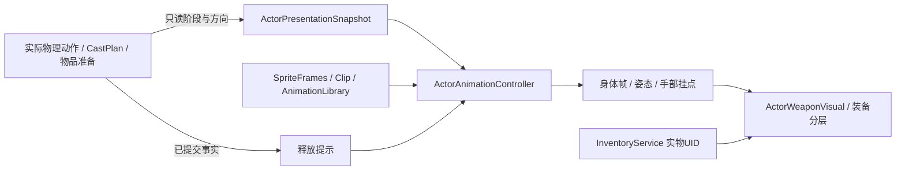

# 角色动画基座与扩充路线

2026-11-09，Godot 4.6.3。当前交付为2D八方向、真实装备分层的动画基座，已进入灰河谷玩家、人形敌人、装备纸娃娃与遗骸。系统和物理动作继续各司其职；数值、命中、冷却与耗材仍由原执行链结算。

## 调研与选择

核对的官方资料：

- [Godot 4.6：2D sprite animation](https://docs.godotengine.org/en/4.6/tutorials/2d/2d_sprite_animation.html)：SpriteFrames/AnimatedSprite2D适合精灵帧；AnimationPlayer适合组织属性轨道。
- [Godot 4.6：Using AnimationTree](https://docs.godotengine.org/en/4.6/tutorials/animation/animation_tree.html)：AnimationTree组织AnimationPlayer中的动画；骨骼/姿态混合和高级过渡适合用树，逐帧2D通常采用离散方向并保留播放相位。RESET提供确定的基础姿态。
- [Godot 4.6：AnimationPlayer](https://docs.godotengine.org/en/4.6/classes/class_animationplayer.html)：seek可更新属性而跳过方法/音频等播放副作用。
- [Godot 4.6：AnimationTree API](https://docs.godotengine.org/en/4.6/classes/class_animationtree.html)：使用Tree后由Tree统一控制播放，不同时混用Player的播放接口。

本项目当前资源是像素精灵，身体方向切换需要离散帧。采用`AnimatedSprite2D + SpriteFrames`绘制身体，`AnimationPlayer + AnimationLibrary`处理身体姿态和手部挂点；逐帧动画不做产生重影的交叉淡化。今后采用Skeleton2D等可插值骨骼时，可在表现rig内部引入AnimationTree，继续沿用动作快照、语义ID、实际装备和事实提示边界。

此前身体基本为静态几何，武器绘制放在ActorActionController里，Player的旧AnimationPlayer为空。现在武器绘制移入独立表现组件，身体、纸娃娃和遗骸共用一套资源。旧Sprite2D保留隐藏，用于兼容原受击颜色等入口；旧状态机的空AnimationPlayer接口保留，正式战术动作由新rig播放。

## 职责和所有权



| 所有者 | 当前职责 |
|---|---|
| `ActorActionController.presentation_snapshot` | 查询实际动作、phase、阶段进度、锁向、family、武器UID。持键准备保存最新实际鼠标运动方向，松开仍按原规则提交 |
| `ActorPresentationSnapshot` | 按死亡、物理动作/失衡/准备、物品/喷洒/施法、格挡、移动、待机的优先级读取角色能力；不执行动作 |
| `ActorAnimationClip` | 语义ID、源帧动画名、姿态名、源前摇/有效期分界、脚步接触点；只读Resource |
| `ActorAnimationProfile` | 原生SpriteFrames、AnimationLibrary、方向、大小、步距、Clip和明确视觉回退；运行查询返回快照 |
| `ActorAnimationCatalog` | 登记可用于真实角色和遗骸恢复的无武器身体配置；拒绝将带绘制武器的参考配置用于角色 |
| `ActorAnimationController` | 本角色瞬时表现时间、朝向、原生播放器、受击叠加、提示信号；不写共享资源或角色位置 |
| `ActorEquipmentVisual / ActorWeaponVisual` | 实际穿戴、涂层颜色、护甲、主副手表现；武器轨迹读取原AttackProfile和实际挂点 |
| `PaperDollView` | 相同身体资源的独立预览实例，读取实际装备UID；不复制角色、不监听战斗释放来重复提示 |
| `GrayriverLootCorpse` | 当前死亡播放倒地，恢复存档直接显示终帧。装备仍读原战利品容器与剩余实物 |

场景组合为`Actor → EquipmentVisual → AnimationRig / WeaponVisual`。rig使用`Reaction → Rig → Body / Sockets → MainHand、OffHand`，PosePlayer只驱动局部姿态和挂点。身体在装备父项之前绘制，使用同层排序，避免负Z使纸娃娃/遗骸的身体落到背景后面。

## 时序、提示与取消

- 身体帧和姿态都采样实际`windup / active / recovery`，再映射到素材的阶段分界。重击、接势和抵扣后的短起手仍对齐实际挥出；反复seek、改变预览速度、掉过有效阶段都不能新增命中或资源消费。
- `AttackProfile.animation_id`只选择表现；为空时按motion及返刃方向选择。普通重击和现有重发武技明确选择对应重发姿态。新语义缺少专用Clip时由配置的回退或待机呈现，实际动作仍保持原形式与费用；诊断显示请求和解析后的ID。
- 实际挥出/离弦成功提交后发布`physical_action_released`，动画组件按本角色与family去重提示。跳过渲染帧不会丢掉事实；提示信号不反向触发伤害。施法释放读取原`cast_committed`。
- 行走相位读取实际移动距离，脚步按Clip的接触点触发，与精灵帧数分开。传送不制造脚步；预览角色没有实际Actor，不产生行走事实。当前信号提供扩展音效/纯视觉的入口，未引入新的音频素材或声音验收。
- 轻微受伤叠加短反应，不覆盖已承诺攻击；失衡与死亡读取真实状态并替换姿态；治疗不会触发受击。菜单接管输入时世界和现有动作继续推进。
- 每次换姿态先应用RESET，再采样新姿态，避免遗漏轨道继承上一个动作的手部偏移。配置校验禁止方法、子动画和越界属性轨道；只允许rig局部位置/角度与双手位置。
- 消费、命中、投射物、碰撞位移与动作结束都不由动画回调决定。新动作仍由原动作执行器验证和结算；动画不能自动延长窗口、补条件、续资源或决定战技命中。
- Animator、准备、反馈与cue去重均为瞬态。离区/读档/死亡等沿原取消协议处理。遗骸额外保存配置ID和朝向值，只通过登记目录解析，未知配置回退默认身体；不读取存档中指定的任意资源路径。

## 素材与当前覆盖

使用Shade的[Puny Characters](https://opengameart.org/content/puny-characters)，作者页标为CC0并允许商业使用。实际下载来自固定提交的公开镜像，与另一独立镜像的Git LFS原始对象SHA-256逐一匹配。三张PNG总计75,088字节，均未修改。原始素材、完整CC0文本、镜像说明与来源散列保存在[puny目录](../content/art/third_party/puny/)。详情见[第三方清单](../content/art/THIRD_PARTY_ASSETS.md)。运行不访问网络。

源图每格32×32，24列、8方向；方向从南开始依次为西南、西、西北、北、东北、东、东南。

| 用途 | 原图列 | 当前策略 |
|---|---|---|
| 待机 | 0、1 | 八方向待机 |
| 行走 | 2、3 | 八方向步距采样，原生姿态轨道补身体与双手起伏 |
| 无武器动作身体 | 15、16、17、0 | 作为攻击、施法、投掷等身体姿态的当前基础，配独立武器/姿态变式 |
| 受击 | 18、20、18 | 受击身体；原19列闪白由现有受击表现承担 |
| 死亡 | 21、22、23 | 倒地与终帧保持 |
| 原素材刀、弓、法杖动作 | 4—7、8—11、12—15 | 含绘制武器，仅在参考预览中使用 |

正式身体为5组基础帧、40个方向片段，复用为22个动作语义和明确的别名回退。现有返刃、四类武器、重发形式通过独立姿态/挂点和实际武器轨迹区分。**目前持盾、翻滚等仍使用基础身体与姿态变式，专用原画尚未补齐**；这轮验证的是扩充机制、衔接与数据路径，不能当成已有完整高帧数美术库。

## 三个可运行demo

游戏内：**Tab → 操作设置 → 动画与素材演示 → 打开动画试验室**。进入前保存正式旅程，保存失败则留在当前游戏。也可以在Godot分别打开场景按F6，或执行：

```bash
godot --path . res://demos/animation_gallery.tscn
godot --path . res://demos/animation_combat.tscn
godot --path . res://demos/animation_casting.tscn
```

1. 素材浏览：三组身体并排，按钮选动作/方向/阶段，暂停、调速、拖动时间轴，显示实际解析片段和帧。参考原图包含武器，并明确标记用途。
2. 武器实战：复用灰河谷正常模拟与真实库存。四类武器、箭、抹布和武技知识为演示初始套装；轻/重击、连招与武技仍手动输入。可调入一个现有敌人，正常AI和资源不变；仅调整对练位置，不中途补满敌人物资。重置整个演示才重建套装。
3. 法阵施法：Q铭刻实际火石阵，阵内E火花触发已学的火球组合，R震荡，1抹布，2投掷。显示真实准备、释放、打断与耗材。没有一键补阵或组合宏。

实战demo采用`AnimationSandbox.MemoryRepository`，保存/读档通过原SaveManager执行，文件读写由内存仓库替换。F5/F9、角色、物资、成长与世界进度都留在本次沙盒，返回后恢复正式旅程。操作偏好仍沿用项目的全局设置；演示调速只用于素材预览，实战不改全局时间倍率。配装、知识和安全起点为演示条件，不代表自然开荒、平衡或目标设备性能验收。

## 以后添加动画的具体流程

1. 保存来源、允许商用/分发的许可、作者和原始散列；保持游戏离线可运行。先分清身体、装备与特效，不能把不会掉落的绘制武器混入身体。
2. 在编辑器创建原生SpriteFrames，按`片段_方向`命名八组方向动画；帧数、时长和纹理切片可不同。创建或复制ActorAnimationProfile，配置大小、偏移和步距。
3. 用ActorAnimationClip登记语义、源分界和脚步接触点。用原生AnimationLibrary编辑局部身体与双手姿态，保证RESET覆盖基础状态，保持轨道在允许范围。
4. 将用于真实角色的配置登记到`content/animations/live_profiles.tres`，并在ActorCharacterData选择它。参考图保持`equipment_free=false`，不进入该目录。
5. 若是现有动作的新表现，在AttackProfile选择`animation_id`；Clip接入后执行器无需新增武技ID分支。新增伤害/位移语义才扩展原领域执行链。
6. 在素材页对照8个方向、源前摇/挥出/后摇、缺片段回退；在实战页验证实际输入、换装/附魔、短起手、取消、受击和真实余量；核对纸娃娃与死亡遗骸。
7. 运行内容校验与对应回归。`tools/build_actor_animation_assets.py`仅重建本轮样本，离线输出原生Resource；手工扩充请创建新命名资源，避免重建样本时覆盖编辑成果。

下一阶段按实际收益推进：先补持盾、专用翻滚和各武器无武器身体原画；再把程序绘制的装备替换为匹配挂点的独立图层；需要骨骼插值/上下身混合时才接入Skeleton2D/AnimationTree。输入、UID、动作阶段、命中与存档边界继续复用，避免更换表现方案牵动整套玩法。

实测、截图和覆盖边界见[动画验证记录](ACTOR_ANIMATION_VALIDATION.md)。

2026-11-09：角色动画现为[全游戏表现系统](GAME_PRESENTATION_SYSTEM.md)的一个分支，新增work_gather/work_craft/work_rest，读取实际现场作业而非自建计时。FieldWorkMethod.animation_id可指定专用片段；本轮仍为共享帧与姿态变式。
