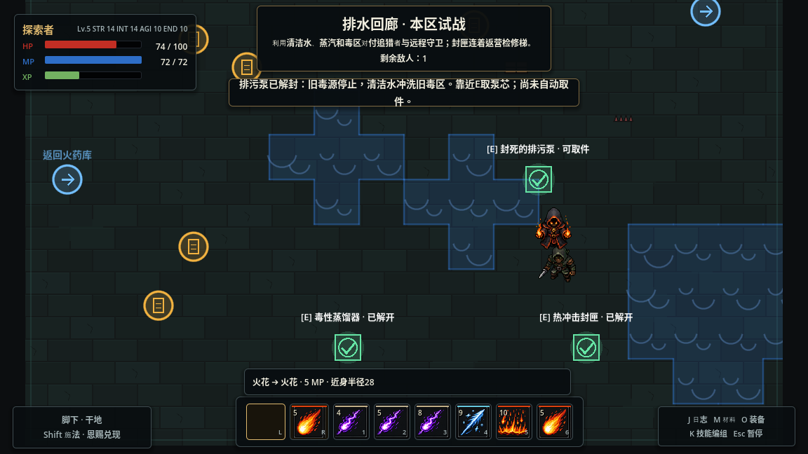
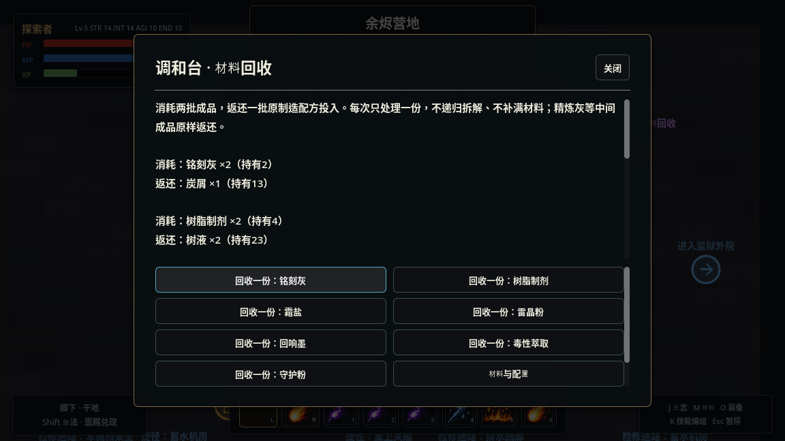

# 重启调和台：属性、法术与现场作业

## 第一批：即时作业基础

现场操作复用交互动作、玩家状态机、SimulationRuntime、现有行囊事务与世界进度。`FieldWorkMethod` 定义操作时间、有效属性门槛及材料费用；`PlayerFieldWork` 负责准备、实时验证和中断，`FieldWorkSites` 接入真实场景。法术与手动作业通过同一个解封入口提交，提交成功后才发布机关完成信号。

E查看后，Q选择方法，E站定开始；Esc收起。操作栏不暂停、不拦鼠标、不设置 ui_blocked。移动、闪避、近战、施法、再次E、Esc、受伤、死亡、菜单、离区或条件变化均取消。作业时间不使用施法加速。观察栏保留战斗能力，施法准备与现场作业互斥。

开始及完成前检查位置（80范围）、当前区域代次、有效属性、装备版本、方法配置、条件与库存。费用在完成事务中扣除，取消不扣材料、无部分进度；同帧别的解法先完成时取消作业。实际HP每次下降都会中断，包括同帧先回血再受伤。

解封、取件分别使用已有 claims，完成方法使用 choices，瞬时计时不存档。部件必须靠近E取走，不进入施法材料行囊。试验记录额外统计成功作业及耗材，旧记录缺失作业字段视为0。

验证：新增 `field_work` 检查覆盖非暂停选择、键盘切换、门槛、延迟扣费、伤害、中断路径、法术抢先完成、单次取件和磁盘恢复；原有内容无新增条目。

## 第二批：任务与回收

新增一张图纸、两个可取件设备、一处营地设施和一项委托。现有9区域、18条敌人配置、11动作、24组合、7材料、7制造配方、4装备保持不变；机关8→10，委托4→5。

| 地点 | 方式 | 持久结果 |
|---|---|---|
| 营地东北 `(360,-180)` | E接取，可晚于探索 | `alchemy.started` |
| 档案室 `(160,-240)` | 调和台检修图纸，不要求清场 | `alchemy.schematic` |
| 回廊 `(192,0)` | 力量14站定2秒；实际火→水→冲击；或凝霜→冲击 | `alchemy.pump_open`，随后E取件为 `alchemy.pump_taken` |
| 机房 `(160,-224)` | 智力14站定2.5秒；实际蒸汽保持0.5秒；或树脂制剂1＋晶砂2站定1.5秒 | `alchemy.regulator_open`，随后E取件为 `alchemy.regulator_taken` |
| 营地调和台 | 已接取、读图纸、取两件后站定3秒，无额外材料 | `alchemy.repaired`，永久回收 |
| 营地委托板 | 交付“重启调和台” | `quest.alchemy_repair`，一次性1属性点 |

首次开泵通过既有清洁水反应处理旧毒区，永久停用对应 authored 毒源。不会强制覆盖玩家制造的其他地面；暂时的水自然消退。失去毒地阻敌的取舍会在提示中说明。调压器首次开封在105半径生成6秒蒸汽，取件、回访、读档都不重复释放。原机关、清场出口、水路选择和Boss影响保持。

所有任务事实沿用 claims，完成方法沿用 choices，并写入J发现记录；不新增任务材料库存、任务存档格式或事件图。图纸和部件可以先找到，再接委托。已清场旧存档保持清场，新增设备可直接探索；“本区试战”与重置遭遇保留解封、取件、修复和领奖状态。

`RepairFacilityData` 只描述固定营地修复目标；`AlchemyRepairService` 接入设施、任务提示与两处首次世界效果。实际机关提交仍由现有进度服务负责。新增交互资源参与障碍净空。日志逐项显示任务步骤，未收集部件不会被解封标记代替。

## 回收规则

`CastingSupplies.recycle_preview()` 只读计算：消耗 `2 × recipe.output_count` 的原成品，返还一次 `recipe.inputs`。`recycle()` 原子提交库存；`CastingWorkshop.recycle()` 重新校验营地、角色存活和修复事实，M和设施E使用同一入口。每次操作一份，费用与返还明示；不新增配方，不递归拆中间成品，不使用装备、属性或恩赐折扣。

- 霜盐2 → 晶砂2。
- 守护粉2 → 铭刻灰1＋晶砂1，不进一步拆为炭屑。
- 制造4份霜盐花晶砂8，回收两次只返晶砂4，循环不会产出材料。

## 检查与试玩

自动化42项通过。新增 `alchemy_repair`、`material_recycling`，并扩展 `field_work`、内容引用和敌人移动检查。覆盖真实法术命中、连续蒸汽与中断、两种属性方法、材料延迟支付及失败、方法/装备/属性/库存变更、执行拒绝、并发解封、距离与区域、单次取件、组装、旧记录缺省、磁盘恢复和遭遇重置。七配方逐项检查预览纯净、批次倍率、原样返还和亏损循环。敌人实际动作及巡逻/返回速度在冻结后为原值30%，移除后恢复，未增加第二套减速结算。

桌面试玩用X11键鼠驱动普通游戏窗口，观察脚本只读遥测，不改角色、AI、资源或计时。角色来自之前正常打通章节的存档：等级5、13个实际获得的未分配属性点、原有库存和四件装备所有权。每条路线分配8点，保留5点；不提高角色上限制造平衡证据。已清场区域通过现有本区试战恢复敌人，无击杀收益。

排水回廊实测：贴着追猎者检修被实际伤害中断；霜盐水引也会冻结自己，不能只看敌人减速。先近战处理远程敌人，拉开后冻结追猎者、闪避脱离冰面，再站定撬拆，可以在存活追猎者继续追击时完成2秒作业并现场取件。完成时追猎者20HP，正常速度150（冻结时45），仍处于追击/攻击状态。未调整敌人或角色数值。

力量14/智力14路线已在桌面完成两处取件、组装和领奖；实际回收霜盐2返晶砂2。无材料法术和材料路线的对照记录见下方后续试玩结果。试玩覆盖功能和局部交战，不据此宣称整条探索路线已经达到20—30分钟或三种方式已经完全平衡。

### 桌面对照结果

从同一份实际获得的存档分支，各花8属性点。法术与材料对照均为力量10、智力10、敏捷14、耐力14，120HP/60MP；相同守阵者指环＋节律护手、动作编组和完整库存。材料路线仅预选水引的霜盐强化。回廊使用本区试战，机房沿用已清场状态，两条路线均经原有捷径返营恢复，无额外补给。

| 桌面样本 | 开封方式 | 施法/近战/作业 | MP | 材料 | 受伤 | 游戏内用时 |
|---|---|---:|---:|---|---:|---:|
| 无材料 | 火→水→冲击；实际蒸汽 | 5/6/1 | 28 | 无 | 37 | 41.8秒 |
| 材料修补 | 凝霜→冲击；密封修补 | 2/6/2 | 13 | 霜盐1、树脂制剂1、晶砂2 | 51 | 45.1秒 |

两条路线均造成60伤害、取回两个部件、完成组装、领取一次奖励。作业次数包括营地组装。数据直接取自真实存档中的试验记录，保留起止属性、装备、编组、材料与费用，见[原始对照记录](playtests/alchemy_repair_2026_11_05.json)。菜单暂停不计时，键鼠工具的游戏内停顿计时；机房未重开敌人，两次不同走位造成受伤差异，单次样本不能证明平衡或速度优劣。

属性路线另用力量14/智力14、100HP/72MP验证了主动敌人下的撬拆与取件。它包含学习重试，不和上述两个干净样本比较总用时。最后一次成功泵芯段使用1份霜盐/9MP进行控场，手动作业自身不花MP、不消费材料；该角色可以在安全时直接使用无耗材的属性方法。

