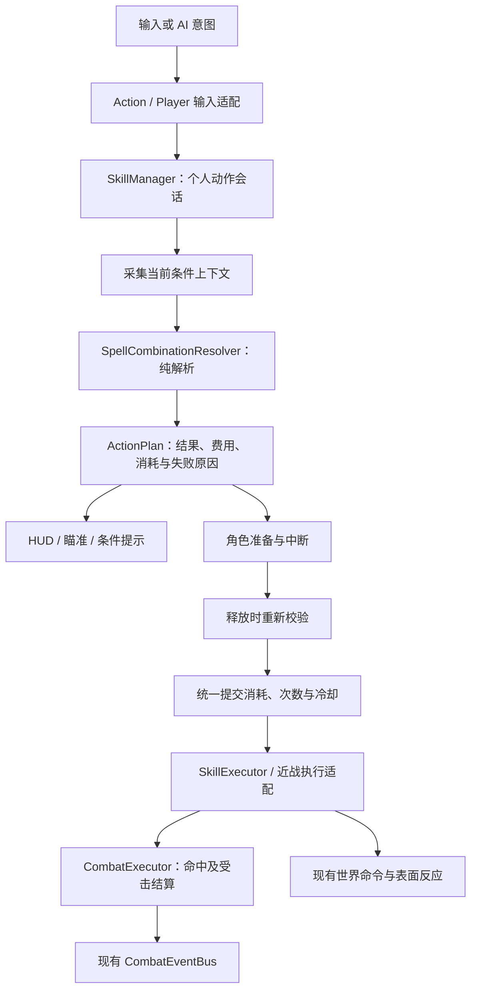

# 条件组合与探索：技术架构评估和迭代方案

> 更新：2026-11-04。本文保留方案评估时的覆盖矩阵和长期设计；下文“当前代码”“缺失”和计划接口名描述早期基线，不能作为现状清单。
>
> 当前探索MVP已实现多法阵相容结果、15条法术组合规则、材料/恩赐、机关、知识发现与持久化。A—D重构已落地CastContext、类型化CastPlan/组件、CastTransaction、StatusInstance/属性重算、HitResult、共享RegionSession和内容验证；详见[重构进展](./REFACTOR_PROGRESS.md)与[当前架构](./ARCHITECTURE.md)。原计划的CastRequest/ActionPlan分别沿用现有CastContext/CastPlan。
>
> “法术组合规则”表示技能、法阵和状态的条件关系；施法材料在规划中修正结果。“制造配方”表示原料转为库存物品，独立使用CraftingRecipe。材料、生存与制造的已实现/后续边界见[施法材料说明](./CASTING_MATERIALS_DESIGN.md)，产品范围见[MVP实现说明](./MVP_RELEASE.md)。
>
> 完整T0/T1、武器准备、防御等仍按产品需求迭代；本轮没有增加装备、生存指标或通用规则语言。Outward参考与组合取舍见[联动复盘](./OUTWARD_INTERACTION_REVIEW.md)。

## 1. 架构判断

现有架构适合继续演进，不需要重写战斗、换引擎或引入 ECS。但完整设计尚不能靠增加几个技能资源实现。

已有底层主要解决“一个技能如何执行、如何命中、如何产生事件、世界物件如何响应”。新设计还需要解决“此刻应该执行哪个结果、准备期间如何变化、怎样只消耗一次条件、能力与世界进度如何长期保存”。

主要缺口集中在：

1. 主动条件组合的数据与纯解析入口。
2. 每个角色的准备、重校验、资源提交和取消生命周期。
3. 角色能力、法阵、武器准备状态的所有权与生命周期。
4. 护盾/格挡/附魔近战的实际受击结算。
5. 探索奖励、区域状态和角色进度的可靠恢复。
6. 基于同一份解析结果的预览、提示与调试信息。

实现原则：复用现有 Runtime、CommandBus、CombatEventBus 和效果执行器。新增的是有明确归属的数据和局部组件，不为每个功能新建全局单例或第二套战斗框架。

## 2. 能力覆盖矩阵

“可复用”表示存在真实调用路径；不表示新方案无需适配。

| 需求 | 当前实现与证据 | 判断 | 处理 |
|---|---|---|---|
| 基础伤害、命中、事件 | `CombatExecutor.report_hit()`、投射物/AoE/近战调用 | 可复用，需扩展上下文和结果 | 保持唯一伤害入口 |
| 法术效果模板 | `SkillData`、`SkillExecutor`、projectile/AoE/Buff/Dash/Summon | 可复用 | 让组合选择结果，不为每个法术组合规则复制场景 |
| 持续状态、刷新、互斥 | `BuffManager` 有时限、叠层、exclusive_group、remove_status | 部分满足 | 增加实例来源、消耗校验、移除原因 |
| 条件纯判定 | `Condition`、`StatusCondition` 可检查 source/target | 部分满足 | 复用纯条件思想，适配主动上下文和原因，不滥用事件 ctx |
| 主动条件组合 | 无法阵/法术组合规则解析路径 | 缺失 | 新增法术组合规则数据与解析器 |
| 准备、中断、条件消耗 | Player 内有蓄力和引导，SkillManager 只检查 MP 并立即执行 | 不满足 | 收敛角色动作生命周期 |
| 法阵 | 持续 AoE 有位置和命中，但没有所有者限额/触发次数/准备查询契约 | 缺失 | 新增法阵实例与小型区域注册表 |
| 武器附魔 | 装备有标签和数值修正；近战直接使用 attack_damage | 不满足 | 武器准备状态与近战上下文适配 |
| 护盾与格挡 | HealthComponent 有无敌；未找到完整格挡/吸收结算组件 | 缺失 | 增加受击防御组件和已结算结果 |
| 状态联动 | SkillSynergyResolver 在 ON_HIT 后触发额外伤害/施法 | 可保留，不等同主动组合 | 规范事件阶段、来源与递归 |
| 材质/表面反应 | SurfaceReaction、SurfaceManager、传播/重生调度存在 | 部分满足 | 修查询契约，增加有限物件反应与来源传递 |
| 已学能力、法术组合规则和日志 | SkillPool 是目录；Player 初始化加入全部 30 法术，精通负责门槛 | 缺失 | 新增角色能力/知识记录，目录与拥有状态分离 |
| 装备改变组合行为 | EquipmentManager 汇总数值；标签未形成统一能力查询 | 部分满足 | 增加有限、类型明确的组合修正 |
| 区域切换 | RegionRuntime.ensure_region()、MarkerRegistry、WorldStateManager | 部分满足 | 显式区域根、稳定对象 ID、切换清理顺序 |
| 唯一奖励和世界里程碑 | 有物件状态和宝箱 opened，但不是统一奖励事务 | 不满足 | 固定奖励入口、领取记录与状态写回 |
| 自动存读与临时/永久隔离 | SaveManager 有版本迁移及扩展 section，但主要恢复 RPG 快照 | 不满足 | 增加明确存档策略与启动顺序 |
| 暂停 | SceneTree.paused 与 SimulationRuntime.is_paused 分离 | 存在已复现缺陷 | 统一控制，并审计 timer/物理/引导 |
| 组合预览 | Player.show_aim() 按原始 SkillData 绘制 | 不满足 | 展示最终解析结果和失败原因 |
| run 模式 | RunManager 和生成器可运行 | 可保留作试验场 | 与探索启动入口隔离 |

## 3. 代码核对发现的约束

### 3.1 当前施法并非统一的准备流程

`SkillManager._execute()` 和 `_execute_with_context()` 存在相似的 MP/冷却/执行逻辑；`ActionResolver` 又检查原始 `skill.mp_cost`，与 SkillManager 的装备减耗计算不是同一入口。

`Player` 单独持有蓄力/引导状态，`_channel_tick()` 可直接调用 SkillExecutor。不能只在快捷槽释放函数中插入条件判断，否则蓄力、引导、近战和被动触发可能走出不同规则。

`CombatPhase` 是一次同步效果计算的阶段，不能拿全局 INPUT/EFFECT 阶段存储持续 0.8 秒的个人准备状态。玩家准备时敌人仍要能够攻击，因此准备会话必须属于角色。

### 3.2 槽位承担了不该承担的能力状态

`SkillInstance` 同时持有技能变体、强化和冷却；`equip_hand/equip_slot` 重新创建实例，`_cooldowns` 又按 source 槽维护一份时间。此前已复现重装同一法术使强化从 1 回到 0。

新方案中，永久强化属于角色能力 ID；临时冷却属于本次探索的角色运行态，键为稳定动作/共享冷却组 ID。槽只映射到能力，不拥有强化和唯一冷却。两个槽装备同能力不能获得两份独立冷却。

### 3.3 当前 Buff 并不等于完整的可消耗状态实例

BuffManager 用 Resource 对象作为剩余时间/叠层表键，具备基本状态管理，但缺少武器来源、应用者、实例版本、消耗票据和移除原因。SurfaceManager 部分路径直接应用加载的共享 Buff 资源。

现有“状态移除”不能自然区分到期、主动消耗、被驱散和场景清理。项目已有 Buff 移除后施法的 Trigger，若加入附魔消耗而不区分原因，会意外触发“到期”效果。

另外，`clear_all()` 当前对每个 Buff 只调用一次 remove_from，而 INTENSITY 应用可调用多次；应在扩展可消耗状态前核对清空与多层撤销的可逆性。这是静态发现的风险，本轮未增加运行复现。

### 3.4 命中事件不是已结算伤害

`report_hit()` 先发 ON_HIT 后调用 take_damage；HealthComponent 可能因无敌直接拒绝伤害。Player 的减伤最终至少保留 1 点伤害，不支持完整吸收。

所以不能通过“收到 ON_HIT 就移除护盾/释放冷气”实现霜卫，也不能把 ON_HIT.data.damage 当成实际损血。需要明确接触、被接受的命中、吸收、实际损血几个概念。

### 3.5 表面、空间与区域接口仍有落差

- WorldSpatialIndex 只注册 MapObject，不是玩家/敌人/法阵的通用索引，且结果默认截断至 32。不能直接用于唯一法阵选择或保证对全体敌人的完整判定。
- `WorldSpatialIndex.query_surface()` 声明返回 SurfaceData，而 SurfaceManager.get_surface() 实际返回 Dictionary。新条件查询前需统一返回类型；本轮为静态核对，不声称该路径已运行报错。
- RegionRuntime 当前通过根节点下“第一个非保留 Node2D”寻找区域；run 会另建竞技场根。两个模式共存时不能继续依赖子节点顺序。
- MapObject 的默认对象 ID 来源于场景和节点路径。编辑场景树或动态生成时，长期存档身份可能变化。
- 门、开关、宝箱的本地状态变化不能假定已经写回 WorldStateManager。当前世界状态更新重点覆盖销毁链，需要逐项补齐交互变化的提交。

## 4. 目标数据流与所有权

这是一次个人主动动作的路径。被动命中联动和世界后续反应仍走现有事件/命令，不倒流回主动输入法术组合规则解析。

| 状态 | 唯一所有者 | 存档策略 |
|---|---|---|
| 内容目录与法术组合规则模板 | 只读 Resource 目录 | 保存 ID/版本，不保存 Node |
| 已学技能、法术组合规则、永久强化、日志 | CharacterAbilityState | 长期保存 |
| 槽位配置 | 现有 Loadout/SkillManager | 保存能力 ID 映射 |
| 准备会话、冷却和取消恢复 | SkillManager 的个人运行态 | 返回营地重置，不冒充永久进度 |
| 法力 | ManaComponent | 按角色恢复/营地策略处理 |
| 法阵时限、触发次数 | FieldInstance | 当前区域临时状态 |
| 媒介与武器附魔 | WeaponPreparationState | 武器切换/区域清理按规则移除 |
| 一般状态/Buff | BuffManager | 按持久化类别筛选，默认战斗状态不跨营地恢复 |
| 门、唯一奖励和 Boss 结果 | WorldStateManager/区域进度 | 按稳定 ID 长期保存 |
| 固定奖励领取与能力授予 | 统一奖励授予入口 | 共同形成一次可恢复提交 |

WeaponPreparationState 只维护武器准备，不能再维护一份与 BuffManager 不一致的倒计时。附魔的持续时间/到期由 Buff 运行实例管理，该组件持有明确句柄并提供武器绑定和使用入口。

## 5. 必须新增的最小组件

名称为建议，实际落地可合并小型纯数据类；不以文件数量衡量完成度。

### A. 法术组合规则与纯解析模块

建议位置：`gameplay/abilities/combinations/`。

- `SpellCombinationRule` Resource：id、trigger_action_id、conditions、priority、result_action_id、费用与条件消耗声明、冷却组、展示信息。
- `CombinationContext` RefCounted：角色身份、动作 ID、已学能力、装备版本、自有法阵句柄、相关状态句柄；只读快照，不修改世界。
- `CombinationResolution`：匹配结果、可执行性、失败原因、总费用、预览数据。无匹配返回基础动作；防御降级按设计中明确例外执行。
- `SpellCombinationResolver`：纯函数式解析，稳定优先级；同优先级用配置 ID 稳定排序并在内容校验中报告意外冲突。

复用现有 Condition 的无副作用接口思想，增加主动上下文适配及失败原因输出；已有 StatusCondition 不能不经适配就读取法阵、武器与知识。首版仅支持有限条件，不做表达式解释器。

### B. 个人动作会话与执行计划

由 SkillManager 拥有一个活动准备会话，可以先实现为内部对象，无需新增全局 CastRuntime。

会话状态：IDLE → PREPARING → READY_TO_COMMIT → COMMITTED → RECOVERY；准备期可进入 CANCELLED/INVALID。成功提交后不得再以“准备取消”退款。

`ActionPlan` 包含 execution_id、输入动作与结果动作 ID、rule_id、总成本、基础和组合冷却键、需要消耗的状态/法阵版本、准备时间及释放位置策略。

预览与执行调用同一个解析器。释放时核对条件、装备、法阵位置/次数、角色状态和资源；计划过期时取消并返回原因，不悄悄改成另一个有副作用的结果。

消耗协调先放在 SkillManager 内：单人同步释放中，全部校验 → 预创建无副作用的结果对象 → 一次性扣 MP/工具/条件 → 接受执行 → 发布事件。提交过程中不 await，不让中途 UI/状态信号重入并重复消费；延迟发出对外通知或设置提交守卫。

长准备不需要长期锁住 MP，释放重校验即可。执行接受前失败可以撤销本地预留；已产生攻击或伤害不能反向回滚。现有 AoE 用 deferred 加入场景，需要明确“已接受待入树”和“入树后取消/区域切换清理”的处理。

### C. 法阵实例与区域注册表

建议位置：`gameplay/abilities/fields/`。

- `FieldInstance` Node2D：instance_id、owner_id、region_instance_id、field_type、半径、持续时间、剩余触发次数、版本与表现。
- `FieldRegistry`：由当前区域生命周期持有的小表，提供按 owner/type 查询，不占用 MapObject 的持久状态或 32 项截断查询。
- 提供 can_consume(handle, version)、consume_once(execution_id)、expire/replace 等明确操作；每次变化使旧句柄版本失效。

法阵不是持续造成伤害的 AoE。只有组合结果才调用现有 AoE/效果执行；法阵只提供空间条件、次数和表现。新阵合法创建后再替换旧阵；角色离开、区域切换和死亡按明确原因清理。

### D. 武器准备状态

建议位置：`gameplay/combat/weapon_preparation_state.gd`，挂在角色上。

处理工具次数、媒介、附魔的互斥关系，绑定当前武器，提供动作查询与条件消耗。附魔的通用计时复用 BuffManager。

当前 EquipmentData 是装备模板，背包也没有完整独立武器实例。首版可用“装备槽 + 当前装备资源 ID + 装备变更 revision”定位附魔对象；更换/卸下对应武器即清除准备状态，不让同一模板的另一把武器继承附魔。若未来要求附魔在背包中跟随具体武器，再引入 ItemInstance UID；首版无需重做全部背包。

左右法术手槽与左右装备槽是不同概念。附魔与近战读取装备的有效武器，不把右手火球的 SkillInstance 当武器。

### E. 防御结算组件

建议 `DefenseComponent` 接入现有 CombatExecutor 的受击路径，管理基础防御窗口和一次性屏障；BuffManager 只负责对应状态的持续和展示。

最小 `HitContext/HitResult` 表达：source、target、execution_id、tags、输入伤害、是否接受命中、blocked、absorbed_damage、actual_hp_loss、killed。结算允许实际损血为 0。

顺序约定：检查目标有效/存活/无敌 → 防御与屏障吸收 → 现有减伤且不重复计算 → 扣 HP → 发布已结算结果。无敌拒绝的命中不消费屏障；实际接受且被屏障吸收的命中最多消费一次屏障。

保留 ON_HIT 的旧语义用于兼容，不能假定已有订阅者都可改变顺序。新增一个有明确用途的 `ON_HIT_RESOLVED` 到现有 CombatEventBus，霜卫和真实损血反馈观察这个事件；回溯迁移旧联动，避免同一效果订阅两处。新增事件不等于新增总线。

Player.take_damage、Enemy.take_damage、HealthComponent 要有适法术组合规则案，确保不重复减伤、不重复扣血、不对 0 伤害强制取 1。不是重写 CombatExecutor，而是在唯一入口下补齐受击结果契约。

### F. 能力、知识与固定奖励入口

建议 `gameplay/progression/`，先两个轻量模块：

- `CharacterAbilityState`：已学动作、法术组合规则、强化，日志条目，稳定 ID 查询与序列化；可以组合内部字典，无需每个字典一个 Node。
- `DiscoveryGrantService`：通过 grant_id 检查是否领取，应用能力/物品/日志奖励，写入领取标记并请求自动保存。被重复调用返回 already_granted，不重复发奖。

世界基础反应不查 spell_rule_learned；主动术式查。SkillPool 仍负责资源索引，精通只提供新的成长策略允许的修正，不再作为另一套拥有清单。

固定奖励首次尽量直接授予，避免“宝箱已保存打开、掉出的唯一物品未捡起就消失”。奖励包与领取标记采用一致存档快照；失败时不记录已领取。以后若支持地面唯一物品，需同时持久化领取前的地面实体。

### G. 有限的世界反应适配

不重造一个通用 WorldSimulation。为指定木障、浅水机关等提供小型 `WorldReactionComponent` 或现有 MapObject 子类，声明可接受标签、反应结果、持续时间、稳定对象 ID 与交互提示。

其数值伤害仍走 CombatExecutor，表面变化仍走已有 SurfaceManager/命令链。冻结水槽属于对象状态变化，不等于任意 SurfaceData 自动产生可走碰撞；该机关需显式碰撞/导航与恢复实现。

### H. 组合预览与知识日志视图

HUD/瞄准读取 CombinationResolution，显示实际结果、总成本和不可用原因。法阵/附魔变化及装备变化使预览失效重算；不让 UI 自己维护另一套条件判断。

知识日志显示持久记录，法术组合规则视图读取只读模板；不从 UI 扣 MP、消费附魔、直接设置 learned 字典。优先扩展现有 HUD/技能编组 UI，不建立另一套技能栏。

## 6. 必须迭代的现有组件

| 组件 | 具体修改 | 完成依据 |
|---|---|---|
| SkillManager | 合并两套执行流程；承接个人会话、统一成本与稳定冷却键 | 普通/蓄力/引导/组合一致检查且不重入消费 |
| ActionResolver | 不再用原始技能费用提前否决已减耗或组合动作；只做基础意图约束并委托实际计划校验 | 预览、可用提示与执行费用一致 |
| Player | 保留输入/瞄准/移动；将准备和引导资源流程逐步交给 SkillManager；保留被动执行的明确入口 | 不同输入路径不绕过主动规则 |
| SkillExecutor / CastContext | 只执行已接受结果；增加执行来源和法术组合规则元数据、显式位置有效标志、接受/失败语义 | 世界坐标 (0,0) 可作为合法施法位置；延迟对象可清理 |
| CombatExecutor / CombatEvent | 受击结果、来源传播、执行 ID/父链 ID、被动触发限制 | 屏障零损血有效，连锁不重复启动主动组合 |
| CombatComponent | 近战携带武器/附魔/动作上下文；一个攻击对同一目标只命中一次，普通和释放斩结果分开 | body/area 双回调不双算，释放斩不重复加附魔 |
| Buff / BuffManager | 定义与运行实例分离；实例来源、版本、消费、移除原因；一致撤销全部叠层 | 消耗不会伪装成到期；清空后属性恢复 |
| SkillSynergyResolver / TriggeredEffect | 区分基础/组合/派生效果；转递执行链来源，统一模拟时间 | 生成的新投射物不会靠下一帧绕过链限制 |
| EquipmentManager | 为合法组合参数提供有边界的修正查询和变更版本；保留旧数值汇总 | 准备时间/法阵半径等生效，卸装可逆 |
| GameRuntime / SimulationRuntime / UI 暂停 | 一个暂停来源；所有模拟 tick 服从它；审计 create_timer 默认暂停行为和技能直接 _process | 菜单停留不掉血、不走法阵时间、不恢复冷却 |
| WorldSpatialIndex / SurfaceManager | 统一表面返回契约；区分配置 SurfaceData 与运行表面快照；补齐反应来源 | 条件查询不靠不兼容类型或截断结果 |
| WorldStateManager / MapObject | 编辑器设置稳定 ID、动态对象确定性生成 ID；非销毁状态也写回 | 开门、开箱、捷径切换区域后正确恢复 |
| RegionRuntime | 显式当前区域根；统一切换时清理法阵/投射物/临时状态/待入树效果 | 没有跨区域残留伤害和旧法阵句柄 |
| SaveManager / SaveData | 明确角色/区域/临时策略、启动恢复顺序、自动保存、版本迁移和安全写入 | 关游戏重开正确，唯一奖励不重复且不丢失 |
| RunManager / main | 模式入口分开；探索入口不执行自动开 run；run 场景用作回归试验场 | 两种模式互不删除对方区域和敌人 |

装备修正先支持有限字段：prepare_time、field_radius、field_duration、spell_rule_cost、release_shape 等，明确作用对象/合并规则/上下限；复杂行为用显式效果资源。不要把任意字符串键拼成未经检查的第二种脚本语言。

## 7. 事件、时间和身份的公共契约

### 7.1 被动与主动分开

主动输入才走 SpellCombinationResolver。被动触发明确标为 triggered，执行结果可复用 SkillExecutor，但不能重新消费主动法术组合规则的媒介和次数。

事件至少传递 execution_id、parent_execution_id、chain_id、rule_id、source_actor_id、effect_index、target_id 和命中序号。一次 AoE 的合法多 tick/多目标要有不同 effect/hit 标识，不能仅按 execution_id 去重而丢掉后续伤害。

已有 MAX_EVENT_DEPTH 和 MAX_CHAIN_LENGTH 可以保留，但异步投射物/延迟执行也要携带链深及链预算。仅使用当前同步回调深度，无法约束跨帧触发。链上下文应有有界生命周期，不能永久保存所有历史命中 ID。

### 7.2 一个模拟暂停语义

UI 可以在暂停时处理输入；法阵、状态、陷阱、冷却、准备时间、近战攻击窗口、无敌窗口都使用暂停感知的模拟时间。首版可统一 tick 或配置 Godot 暂停感知 timer，不要求先建设新的全局时钟服务。

暂停原因应使用来源集合或令牌，避免背包关闭时错误解除仍打开的暂停菜单。恢复不补跑暂停期间的模拟时间。

### 7.3 ID 必须区分用途

- 内容 ID：技能/法术组合规则/装备模板，长期稳定。
- 角色与区域对象 ID：进度和世界归属，长期稳定。
- runtime instance ID/revision：法阵、状态、当前装备版本，只在本次运行有效。
- execution ID：一次施法和事件链，不作为永久学习 ID。

存档不保存失效 Node 引用/运行实例句柄；载入后重建合法运行态。ID 重复和缺失由内容校验报告，不在正式运行时默默以 instance_id 替代持久身份。

## 8. 保存、恢复和探索启动顺序

复用 SaveManager 的 extensions 注册机制存储能力和探索扩展，不再增加另一份独立 JSON 保存进度。

启动顺序：读取/迁移存档 → 建立 GameRuntime 与 providers → 恢复角色能力和基础进度 → 实例化合法营地区域 → 绑定角色、装备和 loadout → 应用装备/成长修正一次 → 清空不应跨营地恢复的状态 → UI 绑定并开放输入。

现有 load_game 主要恢复世界、区域、玩家后再恢复 extensions，新流程不能原封不动沿用，否则组合规则可能在已学法术组合规则还没载入时执行。探索恢复与旧 RPG 全快照恢复应有显式策略；旧槽位不静默改写成新语义。

静态核对还发现 SaveManager.VERSION 为 3，而 SaveData.Root.serialize() 写出 version=2，迁移版本来源需要统一；新 schema 只在迁移实现并验证后确定，不能只改常量。

保存通过临时文件、校验成功后替换和备份策略降低中断损坏风险。角色奖励和区域领取记录必须出现在同一快照；自动保存要在逻辑提交完成后进行，不能在 Signal 回调中保存半套状态。

区域切换顺序：阻止新动作 → 取消未提交准备 → 注销/清理旧区域临时效果与待入树对象 → 刷新需要持久的物件状态 → 实例化新区域 → 恢复稳定世界状态 → 放置玩家 → 开放输入。外出返回/死亡与普通区域切换的附魔清理策略可不同，但必须由入口明确选择。

## 9. 最小交付批次

| 批次 | 必须实现 | 暂不包含 | 验收 |
|---|---|---|---|
| T0：稳定与契约 | 暂停、强化/冷却归属、存档启动与版本、测试模式隔离 | 新组合内容 | 现有相关测试通过；此前三项行为缺陷回归通过 |
| T1：火阵闭环 | 法术组合规则/纯解析、个人准备计划、法阵、MP+次数提交、预览、执行 ID | 附魔、日志界面、区域扩张 | 一次火花预览正确；阵内火球且只扣一次；离阵取消不改结果 |
| T2：附魔与防御 | 武器准备、Buff 实例扩展、近战适配、DefenseComponent、已结算事件 | 通用武器实例系统 | 火附魔普通命中与消耗释放均正确；霜卫吸收一次且不递归 |
| T3：探索持久化 | 能力记录、固定授予、日志、稳定区域根/对象 ID、世界机关适配 | 无缝开放世界、经济大全 | 领取→切区→重启→回访不丢能力、不重复奖励 |
| T4：完整样板 | 其余法术组合规则、装备修正、敌人窗口/Boss、区域串联 | 新元素和符文序列 | 三种构筑完成样板，同一规则有战斗和探索用途 |

T1 先用临时测试角色授予火阵法术组合规则；T3 再接正式学习来源。T1 的计划协议同时预留条件消耗类型，因此 T2 不需要重写它。T0/T1 不要求一次性重构 Player、全部 Buff 和所有存档内容；按涉及路径逐步迁移，旧 API 作为有测试的适配层。

## 10. 验证与内容工具

现有 tests 中没有完整条件法术组合规则/法阵/附魔生命周期测试。旧 run 测试通过只能证明旧流程仍可用。

新增测试应覆盖真实边界：

1. 纯解析无副作用、优先级稳定、失败原因明确、基础动作与防御例外。
2. MP 临界、装备减耗、两个槽同技能共享冷却；重装不刷新。
3. 准备中离阵/换武器/死亡/暂停/区域切换，无消耗或重复执行。
4. 已消耗句柄不可再用，新阵失败不删旧阵；法阵 (0,0) 有效。
5. 媒介互斥、附魔替换、清空叠层可逆；消费不触发到期特效。
6. 无敌命中不消耗屏障，屏障可令实际伤害为 0，同次攻击不触发两次冷气。
7. 组合结果和基础动作不双伤害，派生投射物跨帧不无限触发。
8. 存读、唯一奖励、门/宝箱状态、旧版本迁移、保存失败不记录半次领取。

新增小型离线内容校验：ID 重复、悬空 result_action 引用、条件作用域错误、同优先级冲突、非法费用、未指定持久 ID、缺少提示文本。简单报错即可，暂不建设可视化法术组合规则编辑器。

扩展现有 CombatDebugger：记录 base_action → spell_rule → result、条件快照、失败原因、费用、消耗句柄、HitResult、chain_id。否则“按键没有反应”与“条件不成立”难以区分。

## 11. 不需要现在建设的架构

不需要：ECS 替换、通用能力图编辑器、第二套事件总线、每个法术组合规则一个脚本/场景、全局万能条件数据库、任意脚本表达式、完整 ItemInstance 经济重做、无缝地图流式加载、多人预测/回滚、可恢复任意战斗帧的存档。

第一项编码工作建议是 T0 的三个已复现缺陷及动作/冷却归属回归，然后实施 T1。真正需要优先补齐的是可执行与可验证的公共契约，而非增加更多技能、Modifier 或全局 Runtime。
