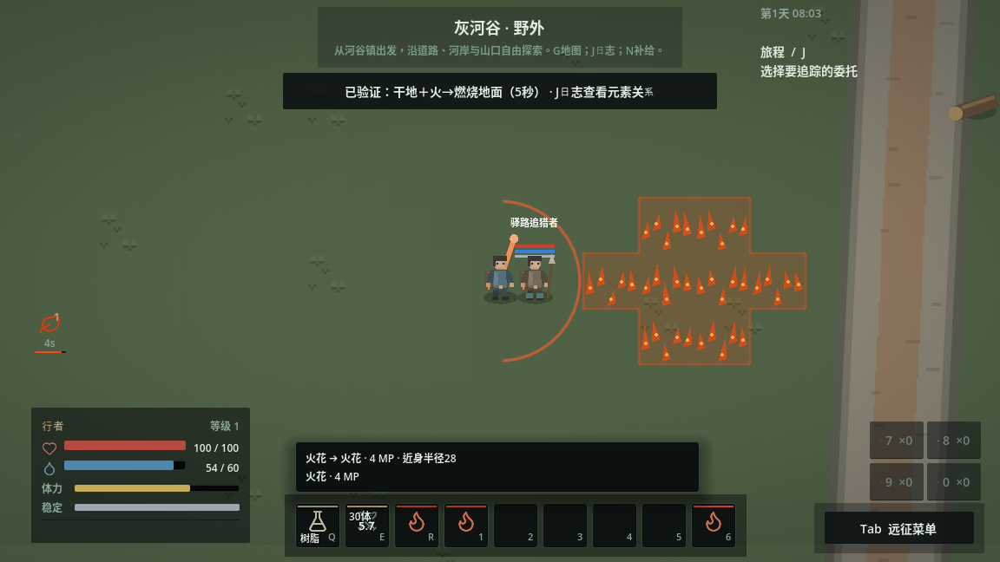
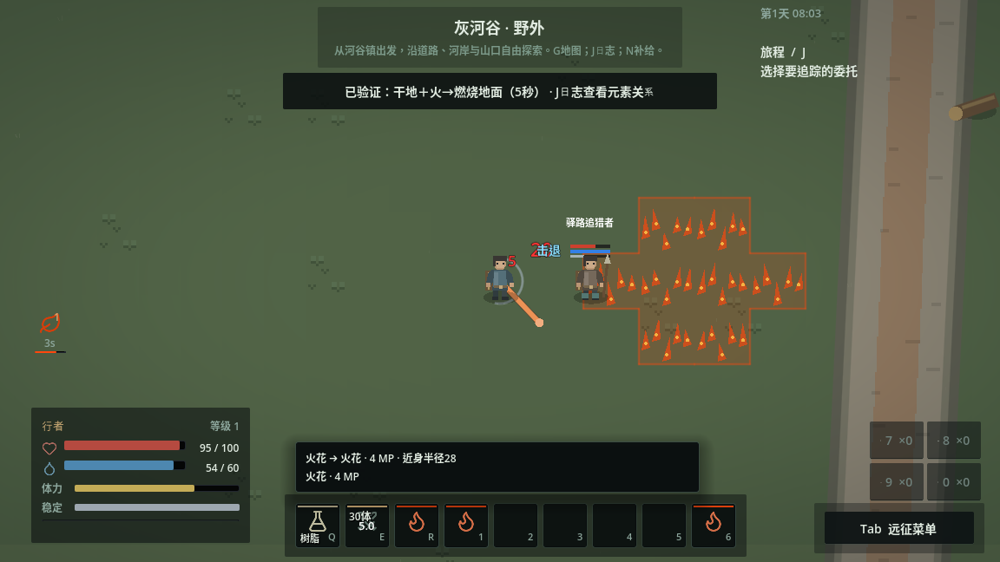

# 对策、站位与材料协同验收

2026-11-07 UTC。代码规则见[当前设计](COUNTERPLAY.md)。本轮沿用地图、敌人、配方与预算；GitHub Actions保持停用。

## 覆盖与平台

Godot4.6.3，云端Linux。原生图形使用Xorg dummy + Mesa llvmpipe OpenGL兼容模式，1152×648；每个图形进程有一次驱动不支持更改VSync的警告。软件渲染与输入截图不证明目标硬件性能或最终动画/音频品质。

`counterplay`覆盖碰撞前踏、攻击承诺/恢复闪避、受击不续满失衡、位移恢复与伤害独立、取消/离区清理、真实火抹布消费、无敌接触不引油、合格命中引油、战术移动实际避险、身体遮挡射界时不花资源，以及朝向别处的起手不触发防御。

`counterplay_input`通过Q/1/E真实键盘事件完成树脂喷洒、火花引燃、横扫投送与持续伤害，并实际保存重进。物资与分阶段站位为机制夹具，目标决策停用，其物理与状态正常推进，不用它说明正常AI平衡。原生进程`/tmp/grayriver-first30/counterplay-input/runtime.log`通过，无脚本错误；截图`/tmp/counterplay-captures/`已检查。

本次样本：MP60→54，喷剂3→2剂；横扫伤害20，目标从距离40被推至104，进入由本次真实材料形成的火地；之后生命35→30。重进保持同一瓶UID和2剂、独立E绑定，不恢复失衡或位移瞬态。

## 正常新档闭环

`/tmp/grayriver-first30/counterplay-expedition/`原生进程通过`tools/playtests/combat_depth_route.json`全部71步，命令记录`/tmp/counterplay-expedition-commands.log`。没有测试增发、冻结敌人或改角色上限：读手册、取口粮、制造火石、北路布阵和火球、拾取短刀/皮甲、返镇出售皮甲得8币、付费训练、K绑定E、第二次交战、实际拾取与返镇保存。

- 守林兵火阵：游戏4.09秒、墙钟4.17秒，受伤0，火石1，总法力成本32，MP60→28。
- 追猎者破势斩+两次普攻：游戏2.60秒、墙钟2.70秒，交战内受伤14，物理成本50体力，MP60→60。
- 全程含交战外中毒累计受伤29，返镇生命73；没有入镇补满。路线自动执行约85秒，仅证明既定路线和预算可行，不代表自然首玩时长。

独立原生进程`/tmp/grayriver-first30/counterplay-archive-reentry/`从本次完成存档在归档源码启动，核对items/pack/gear的实物UID和余量、shortcuts、武技知识、发现集合完全一致，生命仍为73，动作回到idle。命令记录`/tmp/counterplay-reentry-commands.log`，无脚本错误。

## 同档混合遭遇

`counterplay_encounters`先由游戏实际保存有限整备包，再每次恢复完全相同的存档、初始库存与主属性。原有守备兵60HP、术士55HP，AI/物理/玩家原始恢复正常运行。整备包中短刀、油瓶、火抹布以及两名敌人的试验站位属于受控夹具；不把它计入自然获取证据。三个测试输入策略均没有进入产品控制器。

原生进程`/tmp/grayriver-first30/counterplay-mixed-native/runtime.log`通过，无脚本错误；截图`/tmp/counterplay-mixed-captures/`。本次实测：

| 输入策略 | 墙钟 | 累计受伤 | 实付体力总计 | 剩余MP / 实付MP | 实物消耗 | 结果 |
|---|---:|---:|---:|---|---|---|
| 接近后普通攻击 | 4.91秒 | 26 | 82 | 60 / 0 | 无 | 两敌击败，HP74 |
| 火抹布、油瓶、火花和近战 | 7.05秒 | 39 | 60 | 58 / 4 | 抹布1、油瓶1 | 两敌击败，HP61 |
| 相同材料再加频繁侧闪 | 12.98秒 | 100 | 134 | 60 / 0 | 抹布1、油瓶1 | 玩家阵亡，术士余4HP |

体力总计通过真实扣费通知累计，包含投掷和闪避，与只记录已接受近战动作的成本分开；剩余量包含正常恢复。法力同样同时记录支付与恢复；未提交/被打断的火花不记作免费成功。没有为让材料策略获胜而提高伤害、资源或修改敌人预算。

这组结果说明材料能节省部分近战体力，但准备暴露和错误闪避也会付出代价，不能据此认定材料普遍更强。归档回归中另一轮同档样本的受伤与胜负也有波动，毒火反应可使准备者阵亡。存档初始预算一致不等于决策过程、站位和输入时序完全相同，三策略也有不同操作，不能当作只改变一个变量的平衡实验。

## 回归与最终归档

开发阶段完整85/85通过（当时尚未加入混合遭遇记录器），日志`/tmp/counterplay-work-all.log`、`/tmp/mygame-tests-5hp_1o82/`。最终代码提交`e786e1f4dbc3bfb64a91bb636bbbdcc972dc6e71`通过`git archive`导出到`/tmp/mygame-counterplay-clean-mkbWzq`，不携带`.godot`。运行`python3 tools/run_tests.py --suite all --jobs 3 --timeout 120`：首次导入9.9秒通过，最终**86/86检查全部通过**，退出0，无runner诊断。总日志`/tmp/counterplay-cold-all.log`，分项日志与隔离存档`/tmp/mygame-tests-m_sm6u6l/`。

同一归档的原生真实键鼠组合验证`/tmp/grayriver-first30/counterplay-archive-input/runtime.log`通过，截图`/tmp/counterplay-archive-captures/`；独立进程远征重进也通过。随后只补充本验证文档，不改变已验收代码。GitHub Actions工作流仍位于停用目录，未重新启用。

覆盖边界：这是现有武器、控制和空间规则的深化，不是全部武器/材料组合的平衡完成，也没有验证目标硬件性能、完整动画音效或自然首玩时长。

## 受控图形样本

以下是输入机制夹具：目标决策停用，物理/状态运行。第一张展示已铺火地与横扫准备，第二张展示真实击退及进入火地后的伤害，不能据截图推断正常AI胜率。

