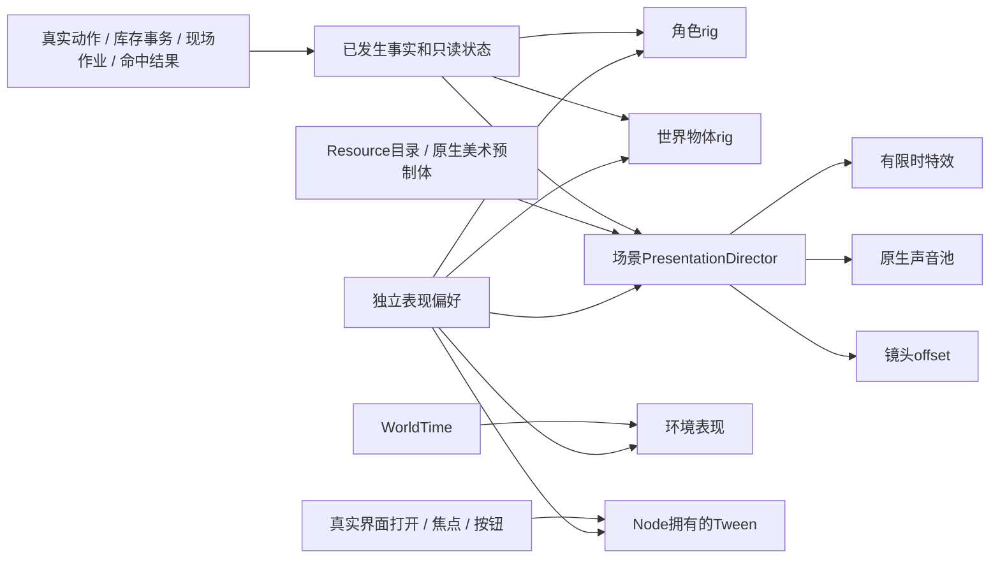

# 全游戏动画与视听表现基座

2026-11-09，Godot 4.6.3 / 2D Compatibility。角色动画是这套基座的一个分支。当前正式接入灰河谷及共同CampaignGame入口的范围还包括世界物体、环境、镜头、UI、一次性特效和音效；“基座完备”不等于所有动作、场景和声音已有最终美术。

## 调研与现有实现审计

官方4.6文档：[AnimationPlayer属性轨道](https://docs.godotengine.org/en/4.6/tutorials/animation/introduction.html)、[Tween动态插值](https://docs.godotengine.org/en/4.6/classes/class_tween.html)、[CPUParticles2D](https://docs.godotengine.org/en/4.6/classes/class_cpuparticles2d.html)、[GPUParticles2D](https://docs.godotengine.org/en/4.6/classes/class_gpuparticles2d.html)、[CanvasModulate](https://docs.godotengine.org/en/4.6/classes/class_canvasmodulate.html)、[AudioStreamPlayer2D](https://docs.godotengine.org/en/4.6/classes/class_audiostreamplayer2d.html)、[音频总线](https://docs.godotengine.org/en/4.6/tutorials/audio/audio_buses.html)。

采用Godot原生场景组合：可编辑的重复姿态用AnimationLibrary；运行目标才知道的短插值用Node拥有的Tween；逐帧图用SpriteFrames；粒子样本用Compatibility可用的CPUParticles2D；环境用CanvasModulate、PointLight2D与局部ShaderMaterial；声音用有数量限制的原生播放器。后续骨骼混合仍可在角色rig内引入AnimationTree，没有再创建一套覆盖所有领域的自制动画语言。

| 分支 | 原有情况 | 本轮落地与扩充入口 |
|---|---|---|
| 角色、装备、遗骸 | 上轮已接入八方向身体与真实装备 | 保留[角色动画](ACTOR_ANIMATION_SYSTEM.md)；新增采集/制作/休息姿态读取实际作业，非必要摆动遵守减少动态效果，实际攻击与位移仍完整表现 |
| 采集、营火、水源、机关 | 主要在物体脚本内静态绘制，状态无共用动画配置 | WorldObjectPresentation读只读状态，WorldAnimationProfile承载原生姿态和可替换美术场景；水井已用真实CC0图集和资源配置替换原绘制路径 |
| 环境 | 河流与地表有独立动画；材质unshaded导致环境光不能覆盖地面 | 昼夜读WorldTime、营火局部暖光、视野内漂浮物、树木轻摆；地面/河水共同响应环境光，装饰运动可静止 |
| 法术/特效 | SpellVisual已有程序效果；trail_scene、hit_effect及声音字段未充分接通 | 接入原生视觉预制体、拖尾、命中特效、AOE效果及声音字段；火球配置实际使用样本。投射物、危险边界和命中空间仍由原系统负责 |
| 镜头 | 跟随与区域边界已有；缺少独立受击反馈所有者 | CameraFeedback只拥有有界offset，实际受伤才震动；可关闭，离区恢复，不设置全局时间倍率 |
| UI | Theme与实时菜单已有，动效分散 | 共用UIMotion/ ButtonMotion提供透明度与焦点过渡，应用于整备、行囊、编组、作业和轮盘；不变形点击区域、不延迟关闭 |
| 声音 | 数据字段存在，部分未被使用 | PresentationAudio按世界/界面分类音量、最多12个原生声音，真正命中/施法/工作/按钮事件触发；不修改别的系统的Master总线 |

## 所有权与事实边界



- CampaignGame创建一个场景拥有的PresentationDirector，注入角色查询、GameplayFacts和真实小时查询；通用组件不依赖GrayriverGame或current_scene选择规则。可在CampaignGame指定PresentationCatalog，在ExplorationRegionData指定EnvironmentProfile；未指定时使用室外/室内默认配置。
- 库存、制造、武器挥出沿原提交事实触发表现。现场作业在成功完成真实事务后发布`field_work_completed`。失败、空间不足、取消与重复领取都不发布成功特效。
- `ON_HIT`表示接受的接触，包含无伤害用途；其声音不承诺实际扣血。镜头读`ON_DAMAGE`，防御反馈读原`defense_resolved`最终结果。恢复、读档投影不会伪造受击。
- WorldObjectPresentation每0.12秒读实际资源就绪/火源/机关状态，动画只写自己的`Visual`子树。首次挂载已完成机关直接呈现终态；不依赖动画结束才提交奖励，不在读档时重新播放完成提示。
- Resource共享且不可变，年龄、去重、Tween、声音与粒子实例归所属Node。世界物体的外部快照返回副本；原生预制体只能使用允许的视觉节点，不包含脚本、碰撞、声音节点、方法轨道或指向外部的动画路径。视觉粒子固定自己的seed。
- 预制体中的原生粒子/AnimationPlayer/AnimatedSprite2D由附着的局部MotionPolicy响应减少动态效果。该策略只调视觉播放速度，完全不触碰Engine.time_scale、角色物理或作业计时。

## 预算、取消与随机性

- 新的一次性装饰效果按低/标准/高限制为12/24/48，较高优先级的完成反馈可替换较低优先级装饰；声音最多12个。去重缓存最多128项。远离镜头的世界提示不创建实例。
- 现有SpellVisual接触闪光使用相同密度选项但保持独立通道上限；持续投射物、法阵、地面覆盖和危险预览仍由实际生命周期负责，不会因装饰预算被隐藏。世界营火粒子每个6/12/18个并做视野判断；环境漂浮物最多32个。
- 离区、F9与重建时清除瞬时特效、声音、镜头偏移、淡入和旧角色观察连接。切场景后的按钮回调重验是否仍在场景树中，防止旧界面继续播放。关闭菜单立即让出输入，不等待退出动画。
- 原生粒子即使固定seed，创建时仍可能影响引擎全局随机源。因此暴击/召唤位置、元素连锁、旧敌人随机掉落、旧宝箱掉落及散布已改由各自节点的RandomNumberGenerator拥有；LootTable只接收随机流，不往共享Resource存运行状态。房间生成与原有风景本来就使用独立随机流。粒子、UI或装饰数量不再改变这些玩法的随机推进。
- 本轮不新增确定性回放或随机流存档协议；以前的全局随机状态同样不随存档保存。真实UID战利品继续保存具体实物，不在读档时重掷。

## 配置新表现

1. **世界物体**：复制WorldAnimationProfile，复用或另建原生AnimationLibrary，含RESET/idle/active/depleted/complete。允许轨道为`Visual:position`、`Visual:scale`、`Visual:modulate`，RESET覆盖全部。填写`visual_scene`可替换身体美术；动态状态仍读原领域。
2. 在SurvivalStationData或SpellPuzzleData的`presentation_profile`指定配置，手工场景的ExplorationInteractable也支持该字段。灰河谷JSON使用同名可选路径；水井`river.well → well_animation.tres → well_display.tscn`是实际例子。其井图只来自已有Kenney CC0图集，碰撞和交互仍由原物体提供。
3. **特效**：在Godot编辑原生视觉PackedScene，支持精灵、CPUParticles/GPUParticles、局部AnimationPlayer和Light2D等白名单节点。预制体先扁平化嵌套实例，不带脚本、碰撞或外部方法调用；自有粒子固定seed。用PresentationCue的visual_scene/SpriteFrames配置通用反馈，或用原ProjectileVisualData的trail_scene/hit_effect配置法术。一次性实例由外层寿命负责销毁，持续拖尾随原投射物销毁。
4. **环境**：复制EnvironmentProfile，设置昼/夜色、漂浮色与数量、风格；在区域资源或JSON的`presentation_environment`登记。需要天气玩法时先由领域建立真实天气状态，再让这里读取，不能靠屏幕雨粒子决定淋湿或产水。
5. **声音**：替换Cue的AudioStream或现有ProjectileVisualData.sound_cast/sound_hit、AOEVisualData.sound_cast。世界音使用2D位置与衰减，UI用非空间声音。减少动态效果不等于静音，两个音量独立。
6. **UI**：沿现有GameUIStyle使用共用按钮/模态入口。额外动效必须保持实际焦点、大小、输入时刻与即时关闭；不要把内容购买、施放、交互或奖励挂在Tween回调上。
7. 先通过`content`与`presentation_system`，再用真实输入验证取消、消费、离区和读档。扩展触及玩法时运行完整回归。

## 整体表现试验场

游戏内：**Tab → 操作设置 → 画面、动效与声音 → 打开整体表现试验场**。角色素材页也有“04 整体游戏表现”。或在Godot打开`demos/presentation_lab.tscn`按F6：

```bash
godot --path . res://demos/presentation_lab.tscn
```

展示区将原有苦叶采集点、常燃柴灶、水井和断桥机关移位排列；材料、装备及撑木知识为明确的演示预设。按定位按钮靠近后，亲手F交互并点击开始：采集、耗材修复、枯竭与机关终态都走原有规则。正常AI仍运行，不自动执行组合或自动完成作业。

“日景/夜景对照”只改演示环境的预览小时，明确不改WorldTime；“恢复真实时刻”重新读取真实时钟。正式游戏默认始终读取真实时钟，休息跳时也会反映到光色。减少动态效果、音量等属于全局用户偏好，演示中调整也会保存。

沿用独立内存SaveRepository；F5/F9与演示成果不进入正式旅程。返回时恢复正式仓库、UID和余量。重置演示才重建预设物资，重进区域或读档不会补满采集资源。

## 资产与后续美术

复用已保存许可和原始散列的Shade/Puny Characters、Kenney Tiny Town与项目UI素材；没有新增不明来源的网络资源。采集摆动、光照、波纹和粒子预制体为项目原生表现；新增4个短WAV为原创确定性合成，CC0，可商业使用，见[声音来源与散列](../content/presentation/sounds/SOURCE_NOTICE.md)。这些声音是集成样本，未冒充环境录音、音乐或完整拟音库。

后续可在上述资源边界补充开箱/门/升降机构帧、采集与制造身体动作、区域环境音与音乐、独立装备美术、骨骼混合和镜头叙事。现有基座支持接入；当前没有宣称已制作所有专用动画、复杂过场导演、天气玩法或完整音频混音工程。完整美术库与目标设备profile仍需逐步制作和验收。

原生窗口与干净归档结果见[整体验证](GAME_PRESENTATION_VALIDATION.md)。

