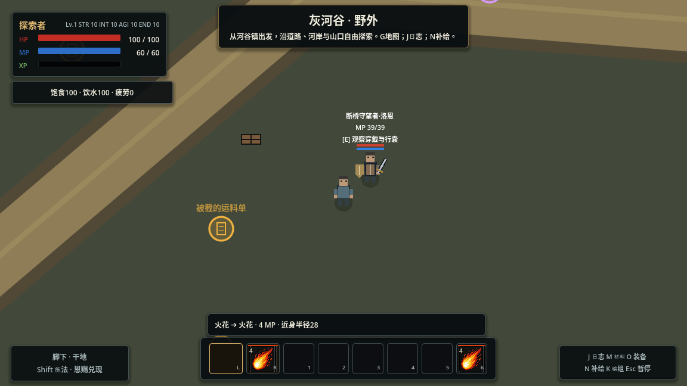
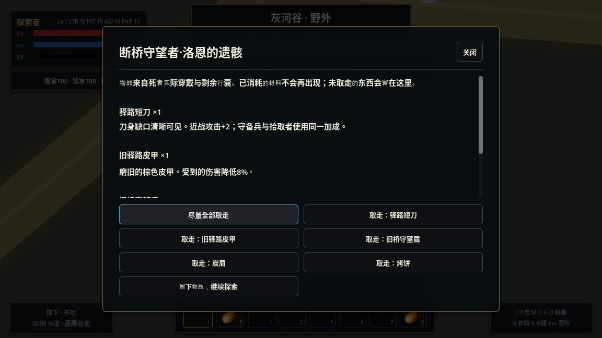
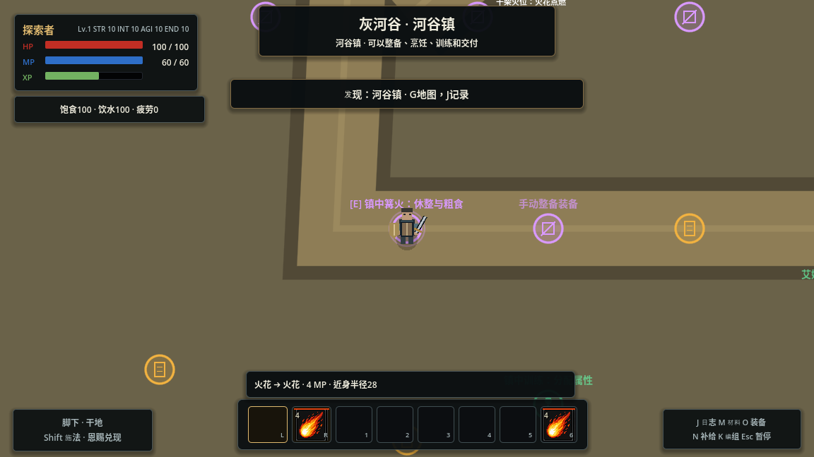

# 灰河谷装备与战利品

2026-11-06。沿用共用角色模板，接通实际穿戴、剩余物资、遗骸搜刮、重复物品件数和持久化。当前灰河谷共有22个遭遇（21个人形敌人与1名领主）、8项委托；基础动作11、组合24、施法材料7保持原范围，章节装备从4件扩充至13种固定型号。

## 所见即所得

- 刀、矛、法杖、皮甲、靴、盾和饰物由实际 `EquipmentManager` 绘制，敌人与玩家复用同一外观与装备资源。旧人物贴图包含固定刀盾，因此人形角色改用不带装备的简化基础身体，避免表现未持有物品。移动保留轻微步行动效、受伤保留闪色。领主与旧验证场敌人继续使用原形象。
- 靠近活着的人形敌人按E，查看实际穿戴及剩余携带物。武器加成与法术增伤在原有属性/施法链生效；护甲减伤提取为玩家与敌人共用入口，仍受原Buff与命中规则处理。
- 灰河谷不再随机生成回血/回蓝球。死亡时读取运行中的穿戴和材料余量，生成遗骸；用掉的物资不会从角色模板补回。灵魂残留与经验继续沿用原规则。
- 遗骸E打开逐件/全部领取。取走一件，其外观随即从遗骸消失；同款装备保留真实件数，不合并为一个“已拥有”标记。背包与水囊容量不足时，只转移实际接收的数量，其余继续留在遗骸中。J列出未取遗骸与所在地区；G用橙叉标出野外尚有余物的遗骸，内部遗迹不混用野外坐标。
- O与I使用同一装备记录；只能在真实镇界内换装。已穿戴的一件从背包数量中扣除，剩余同款仍可携带。物品属于固定型号，没有新加入随机词缀或耐久损耗。

## 三名具名角色与装备

| 角色 | 地点与实际装备 | 携带物与选择 |
|---|---|---|
| 断桥守望者·洛恩 | 西侧旧驿路；短刀、棕色皮甲、桥纹盾 | 炭屑2、烤饼1；盾与甲降低受伤，盾使移动变慢 |
| 矿道运料官·芮克 | 山脚矿道；铜绿测路矛、蓝色工头甲、绑腿靴 | 晶砂2、清水1；矛提高攻击，甲提高力量并降低受伤、拖慢移动 |
| 封锁执事·赫铎 | 旧监狱；金铜佩刀、蓝甲、桥纹盾 | 树液2、守护粉1；佩刀更重，攻击提高但移动下降 |

另外增加普通短矛、炭芯法杖、绑腿靴等装备：普通守备兵实际穿刀甲，追猎者持矛穿靴，术士使用法杖与节律护手。道具说明直接显示现有数值与代价；短矛长度为外观，不暗中扩大攻击判定。

## 运料线的多种处理方式

1. 镇外阅读“被截的运料单”和桥头札记，得知失落货物与相关角色。
2. 可以战斗搜刮敌人的剩余货物，也可以绕路调查倾覆货车，取得固定炭屑2、树液2，再去矿道的工人样品箱取得晶砂2。箱子只领取一次，没有随机抽奖。
3. 回镇向老水工索砾交付炭屑2、晶砂1、树液1。站定2秒，移动、受伤等会中断；成功才扣实际原料，得到谷粮2、苦叶2。来源不限于战斗，原有加工回收也可提供材料。
4. 向艾妲报告“截断的运料线”，获得1属性点，一次领取。可选的“矿道运料官的去向”要求读欠货记录，并从芮克遗骸实际取回至少一件物品，再报告获得1属性点。只击败、只打开面板、容量已满取不到东西均不算完成搜刮证据。

这些可选内容不增加主路线消耗品门槛，不要求某条自动连招，也不回收已经取得的主线成果。

## 存档与防重

`equipment_counts`保存包括穿戴在内的装备总件数；`equipment_owned`兼容旧入口。旧布尔所有权迁移为1件，已读发现的旧奖励登记来源回执，防止重新加载重复赠送。新发现的装备如被容量阻挡，保留在来源，重新调查可领取；领取来源与尸体来源分别计数。

`loot_records`按稳定遭遇ID保存区域、死亡坐标、名称、装备和材料剩余数量。空遗骸仍保留记录，切区、死亡、冷启动读档不会补货或重新抽奖。转移完成遗骸与库存两侧变更后才发布库存通知；每次死亡和转移同步到现有存档流程，保存失败沿用dirty重试及明确提示。

旧存档已击败的旧角色不会凭空产生遗骸。新增三名角色使用独立ID，可以在已清理的内部区域出现；不复活旧守卫，不撤销旧清场。无奖励试战仍有装备战斗效果，但不发新装备、物资、经验或残魂，旧遗骸也不补满。

## 验证与边界

- `grayriver_loot`：运行时换装与死亡快照一致，角色/遗骸/玩家穿戴一致；实际施法消耗不再掉落；容量不足保留、重复搜刮、防止数量折叠；实际护甲受伤一致；完整保存恢复、死亡、切区及无奖励重试；负数数量及未知掉落物拒绝。
- `grayriver_salvage`：非战斗货物来源、真实交付与中断退费、防重复、具名角色与旧清场兼容、实际搜刮证据和任务奖励。
- 当前检查汇总见[验证记录](validation/grayriver_loot.json)。已有完整首章试玩记录属于上一版；本轮未据此宣称新版全程战斗平衡已验收。
- 图形验证使用隔离存档、冻结AI、脚本选取位置及演示死亡/取物，通过实际E输入打开遗骸面板。它验证真实渲染与操作入口，不代表自然新档通关或战术比较。软件渲染驱动的VSync提示已单独记录。

目前没有商店、装备出售、随机稀有词缀、NPC自动吃喝或全局寻路。领主是专属生物，没有可回收的人形服装；其遗骸没有编造装备，原有封存储备仍位于实际探索点。
