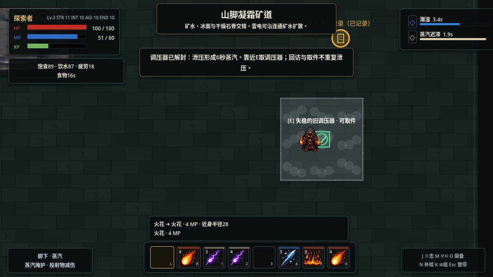
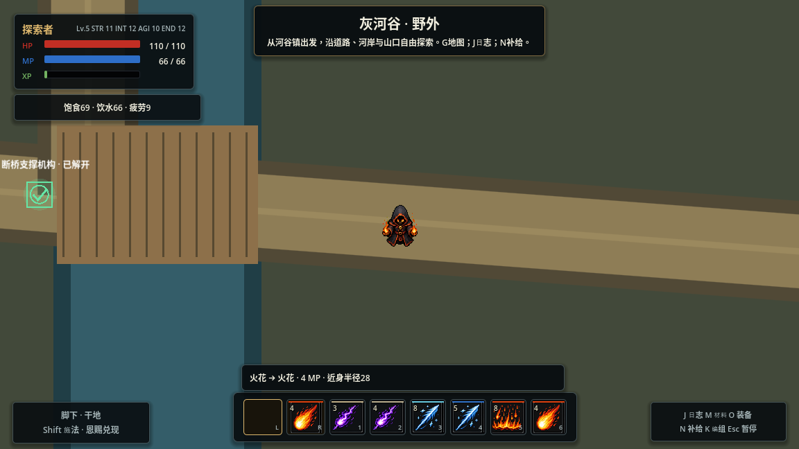
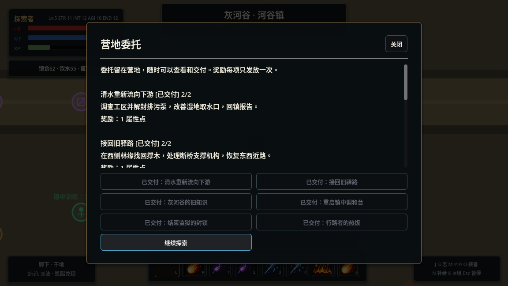

# 灰河谷：首片区域试玩与验收

本文记录第一片区域建设版本的完整试玩。后续人形敌人模板改造、当前参数和最新验证见[共用角色与敌人](SHARED_CHARACTERS.md)。

2026-11-06。灰河谷已作为默认入口，原余烬监狱保留为独立验证场。建设与地理见[地区设计](GRAYRIVER_FRONTIER.md)，操作见[本地试玩](LOCAL_PLAYTEST.md)。本批没有联网发布。

## 已交付内容

- 9600×7200连续野外，8个具名地标，城镇、林地、湖岸、湿地、工区和监狱外道构成可绕行路网；三个遗迹内部沿实际入口往返。
- 24份记录（含路牌和一次性补给）、19个固定遭遇、4处机关、6项镇中委托、2处可修复设施、9个配置的补给/采集/烹饪点（含条件解锁）和1项实物食品交付。
- 沿探索路线学到11个基础动作、24条条件组合、7项材料制造知识、茶与炖汤食谱，并取得4件固定装备。基础烤饼与净水为常识。
- 木桥修复改变真实碰撞；北桥、南浅滩始终有替代路线。排污修复改善取水，前哨支持途中短休和有成本的烹饪，水轮选择影响以后进入的首领。
- 存档3保留位置、角色、库存、知识、单个敌人击败事实和永久成果；原验证场存档2独立。临时地面和本次素材选择不跨区保存。

## 正常新档图形试玩

使用独立用户目录、正常敌人AI、原始角色上限100 HP/60 MP，外部键鼠输入操作游戏；观察脚本只读状态、记录事件与截图，不更改角色、敌人、库存、时间或世界条件。输入辅助知道作者点位，且过程包含诊断暂停与等候，不作为首次玩家耗时或平衡对照。

实际完成路线：河谷镇领取补给、实物交付食品并训练→林地学习火阵→档案窖清理、读取图纸/回响/茶谱/名册→祈坛→矿道战斗、学习雷阵、蒸汽解封并现场取调压器→北桥与湖岸凝霜→工区战斗、检修排污泵和取件、接通实际导电水路并选择冷却→湿地学习、取清洁水→经浅滩回镇组装调和台、交付委托、烹饪和加工→旧驿站建设及短休→取撑木和魂术知识、修桥步行通过→监狱学习、清理并击败首领→撤离、返镇交付。

角色用真实获得的点数增加力量1、智力2、耐力2，最终上限110 HP/66 MP；未强制提高角色上限、发放调试资源或关闭AI。所有19个遭遇与6项委托实际完成，存档读回`completed=true`、死亡0、动作11、组合24、装备4。

### 验证到的联动

| 操作 | 实际结果 |
|---|---|
| 先火阵，再火花 | 火球真实结算，保留独立准备与触发步骤 |
| 本次选择霜盐，再水引 | 敌人冻结；素材消费一次后清空选择 |
| 水引，再近身火花 | 实际蒸汽保持后解封调压器；仍需E取件 |
| 火花→水引→震荡 | 排污泵解封，取回泵芯；湿地水源能装清水 |
| 分流阀补水，再素材水引导电 | 电沿连通水路启动机关，也伤害玩家；水轮开放 |
| 毒性萃取水引→火花→普通水引 | 污染、引燃、处理燃烧依次发生，不重复自动消耗素材 |
| 霜阵，再震荡 | 从新读到的研究记录获得组合用途，并用于监狱遭遇 |
| 修复前哨→短休；修桥→步行通过 | 成果改变途中条件和真实路线 |
| 阅读食谱→制作烤饼/炖汤；学习加工→制造霜盐 | 沿用实际库存、设施与制造费用 |
| 冷却水轮→进入监狱 | 首领初始生命由280降至210，随后正常战斗击败 |
| 撤离准备→移动；再次撤离 | 第一次取消，第二次站定完成，返回镇中 |

撤离未提供额外治疗，返镇后仍按原自然恢复逐步回量；诊断等待造成的恢复不能计作撤离收益。原始汇总见[试玩数据](validation/grayriver_playtest.json)，只统计真实提交的施法/作业与有效回复；工作台的一次加工单独列出，不将事件成本冒充完整资源收支。

## 已修正问题

1. 野外设备界面仍要求整图清场：改用设备周围敌人判断，保留旧验证场默认规则。
2. 地面检测机关放在格边界：调压器与导电机关移到各自格中心，显示真实检测格；不扩大隐形判定。修正后重新实际完成蒸汽流程。
3. G地图在暂停中无法关闭：由常驻UI处理打开/关闭；地图适配默认窗口高度，并显示已发现木桥的修复状态。
4. 续档仍描述首次到镇：改为说明当前恢复地点和存档状态。
5. 导出可能遗漏原始JSON：显式包含灰河谷配置文件。

## 自动化与兼容

完整54/54通过；地图调整后启动与旅程增量2/2通过；另补死亡存档恢复1/1通过。详见[检查清单](validation/grayriver_checks.json)。

新增检查覆盖内容引用反例、知识制造限制、食品交付支付/中断/防重、局部清场、前哨、物理修桥、真实蒸汽/命中/导电、首领选择、逐个敌人持久化、精确位置与生命法力恢复、死亡存档返镇、无奖励遭遇重试、原存档续玩，以及未修桥时全交互点结构可达。既有地面256格与导电48格预算继续由原回归覆盖。

功能测试采用独立fixture控制条件和AI，证明接口与事务，不作为上述正常图形试玩的战斗证据。

## 本地包与验证边界

`tools/export_desktop.py`从干净已提交源码生成Windows/Linux本地包，构建副本只禁用编辑器插件；每次导出执行Linux启动、PE/PCK及ZIP完整性检查，源码版本与校验值见`SOURCE.json`和`dist/manifest.json`。包内附地区设计、操作说明、试玩数据和截图，保留独立可读的相对链接。不上传或发布。

Windows原生交互尚未验证。当前画面沿用原型表现；未加入完整居民日程、贸易经济或第二片地区。材料余量偏宽松，首玩时长和四种战术的同检查点对照仍需专门试玩；本次不据诊断等待调整恢复/掉落常量，也不宣称已达到20—30分钟目标。

