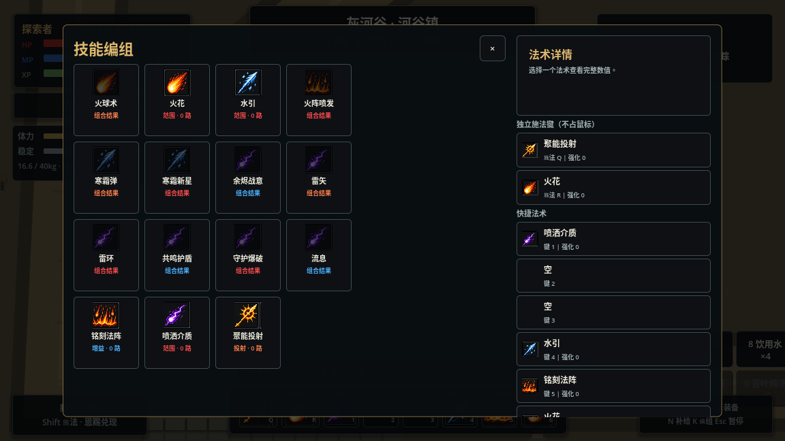
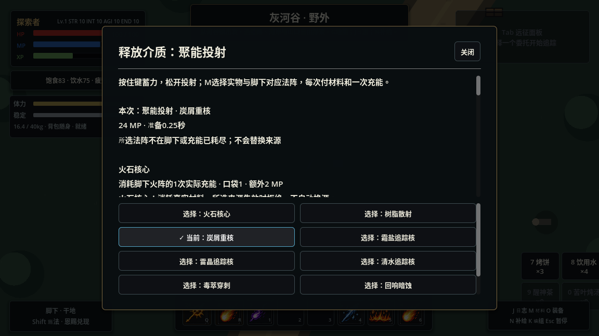
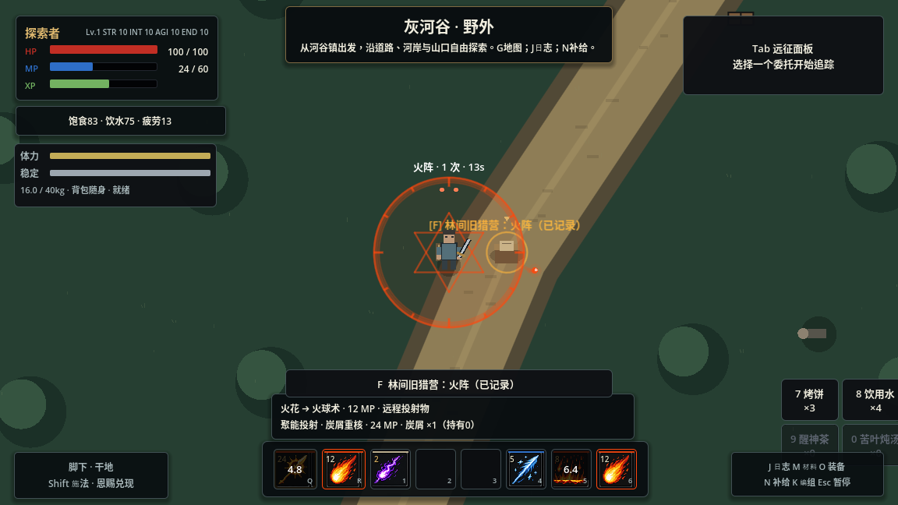
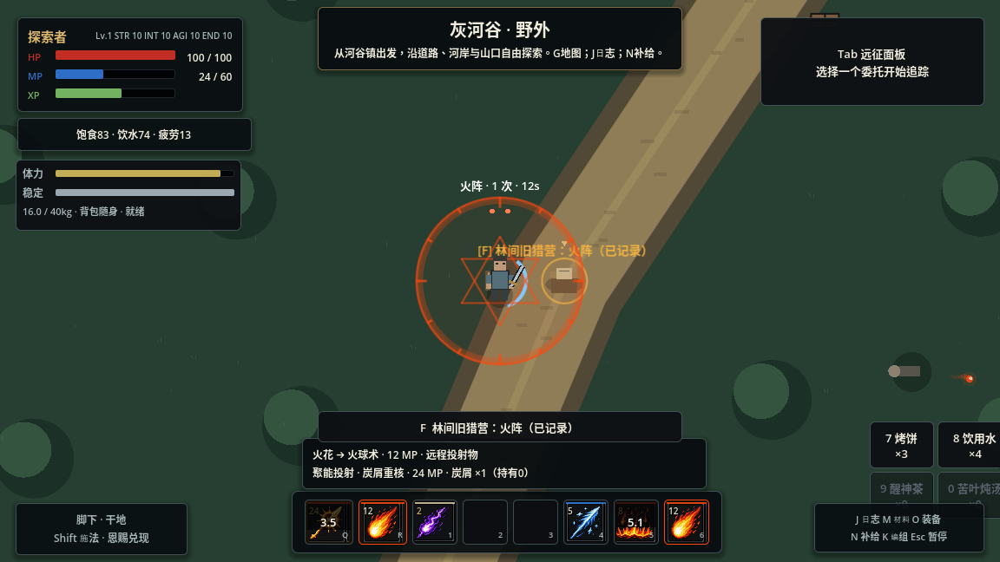
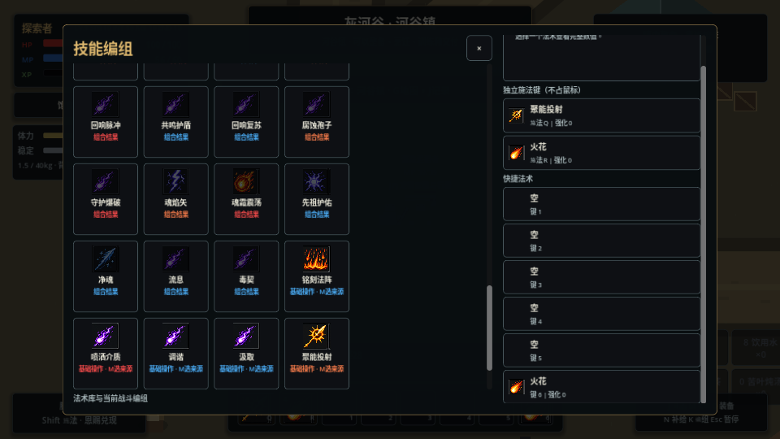

# 独立施法键与历史技能能力接入

2026-11-07，起点 `0f3a5bd`。本轮落实鼠标战斗与键盘施法分离，并逐项处理原房间奖励池的30项历史技能。复用现有操作目录、真实库存、CastPlan/事务与效果执行器，不把旧技能逐个重新变成可免费释放的快捷栏动作。

## 操作与旧绑定

| 默认输入 | 当前行为 |
| --- | --- |
| 左键 | 武器攻击；即使原left槽装备法术，也不会转为施法 |
| 右键按住 / 松开 | 格挡 / 解除；开始格挡先取消未提交施法、蓄力或引导，须实际持有可格挡武器或盾 |
| Q / R | 两个独立施法槽；原left/right存储键保留兼容，但不表示鼠标键；R默认火花 |
| 1—6 | 其余六个编组槽；M选来源，K编组；施法可在设置中改到其他不冲突的按键 |
| F | 交互、调查、打开遗骸；现场作业开始/取消 |
| C | 现场作业切换方法，避开Q施法 |
| E | 遗骸面板全部取走；避开F打开遗骸，防止一次按键又打开又取走 |

左右键固定保留，旧鼠标施法绑定及V格挡设置不再覆盖新约定。旧配置中的E交互默认迁移到F；新布局版本保存后仍可自行改交互键。Q/R和数字槽原编组保留，不丢装备或消耗品。HUD读取当前绑定显示，不再标L/R或引擎内部Physical字样；地图拖动、菜单点击与投掷取消仍按界面上下文处理，不触发世界攻击或施法。

关闭K时由当前窗口处理Esc，远征UI不再先打开另一个暂停菜单。编组卡片/槽内装饰透过鼠标事件，选图标和选槽均可操作；绑定编辑器保护左右键并检查冲突。

## 能力归属

完整逐项清单：[legacy_coverage.json](../content/spell_operations/legacy_coverage.json)。其中5项已有对应能力：

| 历史技能 | 当前替代 |
| --- | --- |
| 火球术 fireball | 火阵＋火花 → 火球；旧直接编组迁移为火花，不附送材料或法阵 |
| 寒冰长枪 frost_lance | 霜阵＋火花 → 寒霜弹，覆盖直线寒冰与状态联动 |
| 闪电箭 lightning_bolt | 雷阵＋火花 → 雷矢，覆盖直线雷电与潮湿反应 |
| 冰爆 ice_explosion | 霜阵＋震荡 → 寒霜新星，覆盖近身冰霜爆发 |
| 毒云 poison_cloud | 喷洒＋真实毒喷剂，覆盖中毒与短暂毒地，须制造或取得实际喷剂 |

这里是用途替代，不表示旧数值、范围和独立冷却完全相同。旧技能树“冰甲结束自动冰爆”不作为新体系承诺；玩家可自己用霜阵和震荡触发爆发，不添加自动组合。

其余25项接为以下操作的效果：

| 操作 | 可得到的能力 | 约束 |
| --- | --- | --- |
| 聚能投射（9种） | 蓄力火球、散射、重核、冰/雷/水追踪弹、毒素穿透、暗蚀、圣火贯穿 | 按住蓄力、松开释放；所选材料＋脚下对应法阵一次充能；通用1秒满蓄，不能通过换材料绕过同一动作冷却 |
| 塑形（11种） | 焚区、火爆区、暴雪、雷场、近身三脉冲、瘴环、浓毒爆区、再生防护、魔像/骷髅/火灵 | 站定0.8秒，所选实物＋指定法阵；骷髅用铭刻灰＋附近真实残魂；地面区域固定于释放位置，召唤物临时存在 |
| 移形（3种） | 短移、附带近战增益的突袭、长距离脱离 | 晶砂/回响墨/铭刻灰＋脚下凝能阵充能；移动逐步通过物理碰撞，不能穿墙；共用冷却 |
| 引导介质（1种） | 冰风暴的持续定向压制 | 按住每0.4秒消费霜盐1份及基础12MP/秒累计结算；松开、耗尽或选源变化即停；区别于120距离的近身喷剂锥形，它在前方200处形成短暂范围 |
| 调谐新增来源（1种） | 冰霜护甲 | 霜盐＋脚下霜阵一次充能；与普通借霜阵调谐分开明确选择 |

这些是操作配方与效果，不是25个新增独立技能。M显示材料、来源及效果说明；同一材料可按塑形样式选择持续区或近身爆发，仍逐次支付实物。基础MP以动作费用为下限，高费效果加上相应额外MP；疲劳、属性、装备和恩赐继续参与总费用和准备时间。强技能不因进入新操作就变成基础低费技能。

## 新接入效果的实物与来源

| 历史效果 | 当前操作 | 实物 | 明确来源 |
| --- | --- | --- | --- |
| 奥术突进 `arcane_dash` | 移形 | 晶砂×1 | 凝能阵 |
| 白灾暴雪 `blizzard` | 塑形 | 霜盐×1 | 霜阵 |
| 蓄力火球 `charged_fireball` | 聚能投射 | 火石×1 | 火阵 |
| 余烬齐射 `cinder_volley` | 聚能投射 | 树脂制剂×1 | 火阵 |
| 余烬球 `ember_orb` | 聚能投射 | 炭屑×1 | 火阵 |
| 烈焰风暴 `flame_storm` | 塑形 | 火石×1 | 火阵 |
| 冰河之眼 `glacial_orb` | 聚能投射 | 霜盐×1 | 霜阵 |
| 冰霜护盾 `ice_armor` | 调谐 | 霜盐×1 | 霜阵 |
| 冰风暴 `ice_storm` | 引导介质 | 霜盐×1 | 只用实物，逐次消费 |
| 熔岩池 `magma_pool` | 塑形 | 树脂制剂×1 | 火阵 |
| 瘴气环 `miasma_ring` | 塑形 | 毒性萃取×1 | 凝能阵 |
| 相位闪现 `phase_blink` | 移形 | 铭刻灰×1 | 凝能阵 |
| 疫病穿刺 `plague_bolt` | 聚能投射 | 毒性萃取×1 | 凝能阵 |
| 辉光圣盾 `radiant_aegis` | 塑形 | 守护粉×1 | 守护阵 |
| 暗影弹 `shadow_bolt` | 聚能投射 | 回响墨×1 | 凝能阵 |
| 暗影步 `shadow_step` | 移形 | 回响墨×1 | 凝能阵 |
| 日耀长枪 `solar_spear` | 聚能投射 | 守护粉×1 | 火阵 |
| 静电新星 `static_nova` | 塑形 | 雷晶粉×1 | 雷阵 |
| 雷暴领域 `storm_field` | 塑形 | 雷晶粉×1 | 雷阵 |
| 召唤苔岩魔像 `summon_golem` | 塑形 | 晶砂×1 | 凝能阵 |
| 召唤骷髅 `summon_skeleton` | 塑形 | 铭刻灰×1 | 真实残魂 |
| 召唤余烬精灵 `summon_wisp` | 塑形 | 炭屑×1 | 火阵 |
| 雷鸣球 `thunder_orb` | 聚能投射 | 雷晶粉×1 | 雷阵 |
| 潮汐灵球 `tidal_orb` | 聚能投射 | 清水×1 | 凝能阵 |
| 剧毒爆发 `venom_burst` | 塑形 | 浓缩毒剂×1 | 凝能阵 |

## 学习、迁移与生命周期

沿用现有发现点：旧猎营火阵记录教授聚能投射，苔石祈坛教授塑形，湖岸凝霜记录教授引导介质，矿师导电记录教授移形；记录补充K编组、M选材和用法。已读旧档只回补知识，不重发材料和装备，不增加地图、敌人或奖励包。旧奖励ID编组映射到对应操作，选择来源保持为空，不能自动替玩家准备材料或现场条件。

每次新操作仍通过同一事务支付真实口袋库存、MP、法阵充能或残魂。来源不存在时拒绝；准备期间来源失效或执行器失败时不扣资源。接受时保留蓄力倍率，之后不会重新采样输入把半蓄变满蓄。引导预览与HUD显示每脉冲法力上限（基础5/次），实际按累计整数法力付款；第五次可能仅4MP，不能因预览上限拒绝这一可负担脉冲。Shift意图在开始引导时保留，不把上一脉冲的消耗退回，也不换另一种介质。剩余实物、编组和知识通过原v6存档保存；瞄准、引导、选择及现场法阵不保存。

召唤效果保留既有寿命与数量上限，不制造永久物资；共同命中入口与投射物/范围效果识别召唤物的战斗所有者，主人与自己的构体互不造成有害命中。未给现有NPC编排新增连招或免费材料；本轮也不声称完成宠物装备、随从背包或完整召唤物社会系统。

## 验证

`test_keyboard_casting`用实际鼠标和键盘验证左键在装法术后仍攻击、右键格挡/松开、R施法、K图标选择与Q槽编组、Esc返回、Q蓄力及右键取消不漏释放。`test_legacy_operation_coverage`遍历30项归属，实际执行25种新效果，检查实物/MP/充能/残魂消费、执行拒绝回滚、护甲/召唤、己方召唤物归属、引导耗尽和换源、位移碰撞、已读记录补学不补货。它使用受控夹具，不作为自然通关或平衡结论。

原生图形沿用游戏生成的旧档与原预算，F打开工作台制火石，K鼠标选择聚能投射编入Q，M选来源；装备先前实际拾取的短刀，整理火石到口袋。右键取消Q蓄力未花物资；之后手动布火阵，以Q蓄力释放炭屑重核、左键挥刀、右键格挡，再以R触发阵内火球。提交费用分别8/24/12MP，共44MP，消耗火石1、炭屑1和阵充能2。旧档中附近守林兵已击败，因此这证明正常模拟中的操作与资源流程，不代表新的战术平衡对照。

保存并关闭游戏，将该游戏生成档放入另一个隔离目录重新启动；编组、知识、口袋/背包/装备UID、材料和发现一致，消耗实物不恢复，选源/法阵/蓄力/引导为空。[结构化证据](validation/keyboard_legacy_skills.json)。完整冷归档回归在交付记录补充。当前素材经济和强技能成本仍需多样本试玩校准，不能由能力覆盖率推出平衡完成。

原生图形受控回归还验证了960×600窗口中滚动到第6槽、鼠标选图标编入Q、返回世界施法及右键取消。UI事件按Viewport局部坐标投递，键盘与战斗鼠标经Input事件和原生指针；它与上述原预算路线分别记录。

纯内容构建曾过早加载完整操作/效果目录，两个检查退出时报资源泄漏；章节改为直接引用四个基础动作定义，操作目录继续在角色装配时加载。修后内容、路线、战役和输入专项4/4通过，完整冷归档需在此修正上复验。

