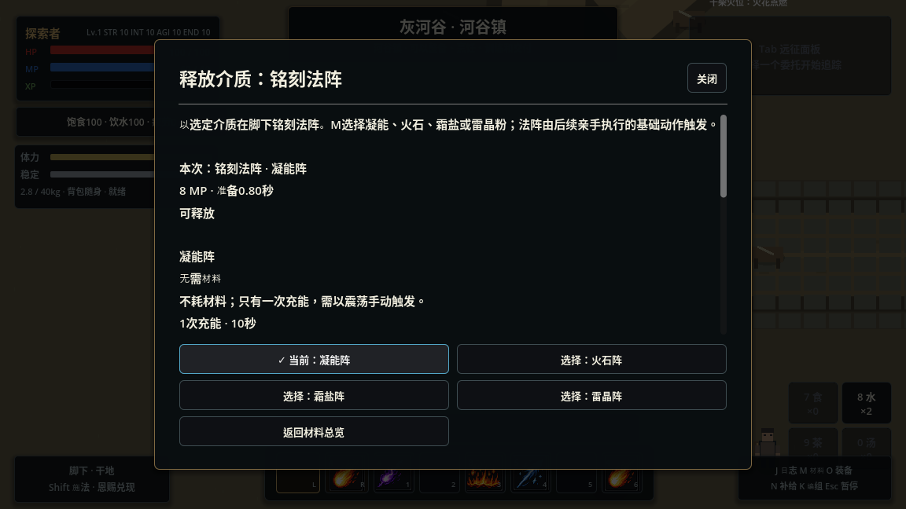
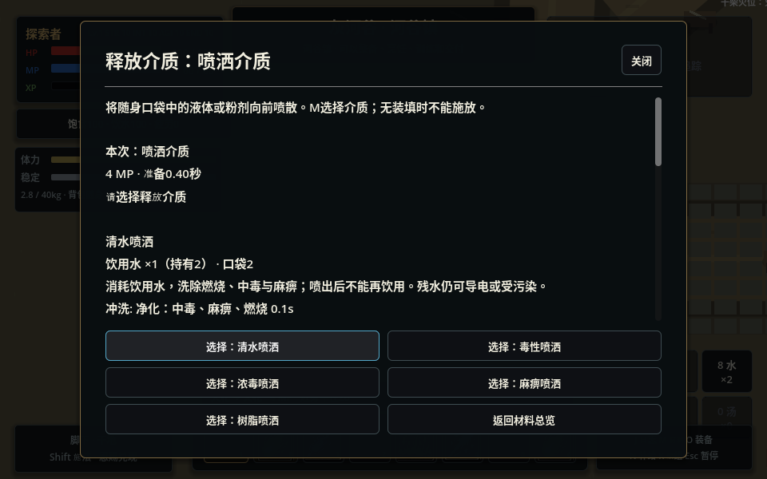
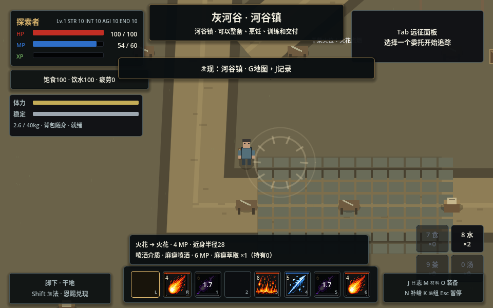

# 基础动作与释放介质

2026-11-07。本轮把“如何释放”和“释放什么”分开，接在既有 CastPlan、CastTransaction、命中与元素反应链上。当前灰河谷启用新规则；旧验证场保留原动作数据作为兼容验证入口。

## 已实现的动作层

- **铭刻法阵**：在脚下准备一个空间条件。动作决定准备时间、基础法力、冷却与放置范围，介质决定阵型、充能和寿命。所有阵型共享同一个动作冷却，换料不能绕过冷却。
- **喷洒介质**：向前释放一团短程范围效果。动作决定方向、距离、半径和准备时间；液体或粉剂决定药效、强度与地面变化。没有选材或口袋里缺料时不能施放。
- **火花、震荡、凝神**继续作为独立的点燃、冲击、调谐动作。它们读取现场法阵、地面、状态和装备，触发既有反应；没有自动刻阵、自动补条件或组合宏。

旧火阵、霜阵、雷阵的编组映射到 `inscribe`；旧毒雾、毒云、泼洒树脂映射到 `disperse`。编组恢复会合并槽位里的重复铭刻/喷洒动作。旧知识 ID 保留给剧情、配方与反应条件使用，但当前 K 界面不再把这些旧变体列成多个可编组动作。

掌握基本操作后，使用已有介质不需要再学一遍“毒雾技能”或“麻痹雾技能”。制造配方仍需要学习；探索获得或从敌人身上取到的成品可以直接用于已掌握的动作。学会某个反应仍是独立的知识，例如会铭刻霜盐阵不意味着已经掌握它对所有基础动作的响应。

## 当前介质

| 动作 | 介质与实际消耗 | 结果 |
|---|---|---|
| 铭刻 | 凝能，不耗材料 | 10秒、1次充能；由之后手动执行的震荡触发 |
| 铭刻 | 火石×1 | 火阵，15秒、2次充能，接既有火阵反应 |
| 铭刻 | 霜盐×1 | 霜阵，15秒、2次充能，接既有霜阵反应 |
| 铭刻 | 雷晶粉×1 | 雷阵，15秒、2次充能，基础额外1 MP |
| 喷洒 | 饮用水×1 | 洗除中毒、燃烧和麻痹，留下水地；饮水库存随之减少 |
| 喷洒 | 毒性萃取×1 | 目标中毒：每秒3伤害、持续5秒；另留普通毒地10秒，基础额外2 MP |
| 喷洒 | 浓缩毒剂×1 | 目标中毒：每秒6伤害、持续8秒；不铺设普通毒地，基础额外3 MP |
| 喷洒 | 麻痹萃取×1 | 1.5秒限制移动和发起动作，不造成毒伤，不生成毒地；基础额外2 MP |
| 喷洒 | 树脂制剂×1 | 铺设可点燃的油地 |

铭刻基础8 MP、准备0.8秒、冷却8秒。喷洒基础4 MP、准备0.4秒、冷却2秒；前方偏移68、半径68，接触效果存在0.5秒。属性、疲劳、装备和恩赐仍会参与最终费用/准备/效果规划，M预览显示当前实际总费用。

喷洒是向前的一团范围效果，不是全屏投放或任意远距离指定落点。命中仍检查墙体视线，拒绝的命中不施加药效。毒地、水地、油地继续使用现有表面系统，因此能被清洗、导电、点燃或污染。浓毒和普通毒剂不是只有颜色不同：直接附着强度、持续时间与是否铺地都有区别。

## 采集、制造、生存和敌人

新增三种实物与配方，直接使用既有真实容器与制造事务：

- 火石：炭屑2＋晶砂1 → 火石1；行路手册教授。
- 麻痹萃取：苦叶2＋晶砂1 → 麻痹萃取1；毒性萃取的探索记录教授。
- 浓缩毒剂：毒性萃取2＋苦叶1 → 浓缩毒剂1；同一炼毒记录教授。

苦叶沿用现有再生采集点，矿物和炭屑沿用既有搜刮来源；未新增自动补货。已读记录会提供新增的配方知识，不重发记录奖励。容量不足、材料不足或执行拒绝时维持事务回滚。

背包中的介质不能隔空用于战斗，先在安全时通过 N 整理到口袋。放下背包后仍能使用已经备在口袋里的材料。饮用水喷出去后就不能再喝，药剂与制造/回收消耗同一份库存。补给页显示材料的释放用途，可进入 M 对应选材页。

刻阵术士也映射到共用铭刻动作，并从自身真实库存消费火石。新建术士有两份火石，已存在的角色仍以存档库存为准，不从模板补货。死亡战利品读取实际剩余数量。对中立角色使用有害控制也会引发敌意，零直接伤害不能规避关系后果。

## 操作和准备规则

M 打开动作与介质选择，K 编组基础动作。选择不扣物品；实际施放成功才付款。选定的释放介质在当前区域保留，可以连续手动施放；每次都要重新经过冷却、准备、资源和现场条件校验。材料耗尽会明确拒绝，不自动切换材料或改用无材料阵。

“释放介质”与原有“单次改造素材”是两种用途：后者仍成功一次后清除。离区、死亡和读档清空两类准备。铭刻未显式选材时使用凝能阵；喷洒没有隐式默认材料。菜单中的当前选择和键盘焦点保持一致，960×600窗口也能选择全部介质。

准备期间换料、库存被花掉、移动中断、受伤、受控、离区或目标失效时不误扣材料与法力。执行器拒绝也会回滚材料 UID、选择与法力。法阵只建立条件，不会自动触发后续动作。

## 架构与扩展入口

```text
SkillManager：Action / 旧ID编组适配
  → SpellOperationData：如何释放
  + SpellPayloadData：材料、强度、状态、地面、阵型
  → 运行时 SkillData 变体
  → CastPlan 预览 / 重新校验
  → CastTransaction 支付真实口袋库存
  → 原 SkillExecutor / CombatExecutor / SurfaceManager
```

操作目录在角色装配时注册，不在地理章节构建时导入；旧章节目录保留迁移所需 ID。定义均为 `.tres`，构建计划时复制运行时变体，不改共享资源。`SpellOperationCatalog` 集中引用动作、介质、配方和新增反应。增加一种同类药剂时，定义 ItemData、配方和 SpellPayloadData，再挂入目录即可；不新增“强毒雾技能”或另一套扣血执行器。

`SkillData.contact_statuses` 让材料携带具体状态定义。命中链先捕获先前状态、执行原有 ON_HIT 反应，再在状态资格被接受时施加这些定义；匹配的元素默认状态不会重复覆盖材料毒素。麻痹由 Buff 的 `prevents_actions` 和移动倍率表达，敌我共用动作与施法入口都检查它。

存档文件版本升为5，v1—v4按原有逐级迁移路径读取。新的操作 ID 会在恢复编组前注册；实际物品结构和 foundation schema 维持原格式。准备选择不写入永久存档。较旧客户端看到 v5 时保留其未来版本保护，不覆盖新存档。

## 验证范围

`tests/test_spell_operations.gd` 覆盖旧/新编组恢复、无材料凝能阵、手动触发与充能、换料/耗尽/执行拒绝回滚、口袋与背包边界、真实物理喷洒命中、毒素强度进入实际 DOT、麻痹/恢复/清洗、中立角色敌意、制造、NPC 火石消耗与掉落余量。

`tools/capture_spell_operations.gd` 检查真实鼠标选材、当前选择的键盘焦点、960×600布局，以及关闭菜单后实际快捷键施放与实物消费。工具为展示主动给予了材料；菜单使用游戏自身的暂停规则，不是自然通关或资源平衡试玩。云图形使用 llvmpipe，不据此承诺真实硬件帧率。

本轮没有随机词缀、药剂实例品质滚点、自定义配方编辑器或完整喷射流体模拟。药剂强度是作者定义的不同实物类型；后续可以在同一模型上扩展材料和形态，仍需逐项校验反应与平衡。





## 2026-11-07 验证结果

- 实现提交 `095374c925b01aa873a436f276e1890810d22198` 以 `git archive` 导出到新目录，不带 `.godot` 缓存；首次导入通过，完整回归 **63/63** 通过。云日志目录：`/tmp/mygame-tests-af3obatv`。
- 同一归档提交运行图形探针通过：真实鼠标选材不扣物品，键盘焦点跟随当前选择，960×600布局可操作；关闭菜单后实际 `skill_5` 输入完成麻痹喷洒，消耗一份真实药剂和6 MP。图形日志：`/tmp/material-ops-cold-graphics.log`。
- 回归包含纯内容/地理入口退出清理，没有残留资源诊断。`git diff --check` 通过；GitHub Actions 未启用，未生成桌面发布包。
