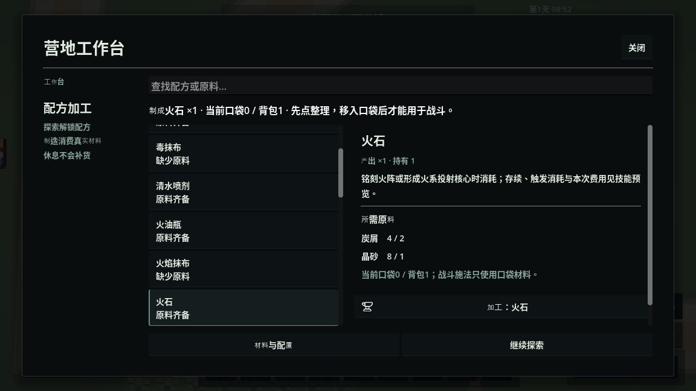
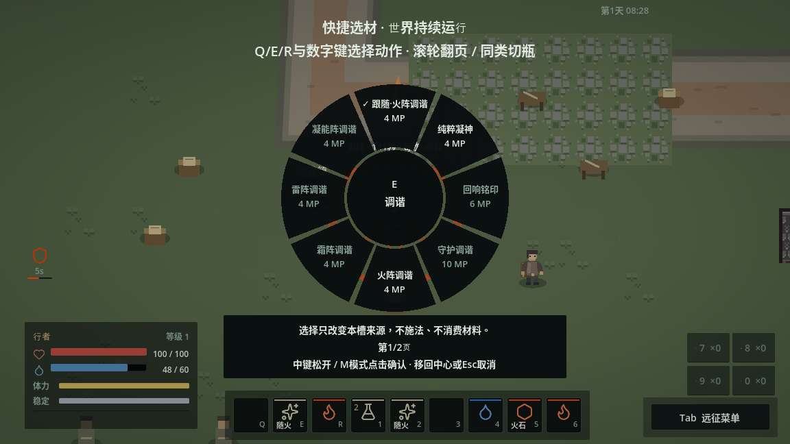

# 操作闭环与智能施法

后续审查见[智能施法与操作衔接复查](FOLLOWUP_UX_REVIEW.md)：发现智能模式与水面组合等交叉路径的待修问题。下文保留本轮交付与原验证范围，96项通过不代表覆盖后续发现的全部路径。

2026-11-08。本轮落实[试玩复盘](PLAYTEST_FLOW_REVIEW.md)的六项衔接问题，并加入同元素形式跟随。地图、敌人、配方投入、战斗数值和动画保持既有配置。现代化体验继续按“操作与反馈→战斗可读性与AI→视听与性能”分批推进，本轮没有完成全部3A质量目标。

## 玩家操作

- **智能跟随**：读取最近一次成功提交的法术元素，为跟随槽选择该动作资源目录中首个对应元素形式。例如亲手布火阵后，调谐为火阵调谐、汲取为火阵汲取、聚能投射为火石核心。界面显示当前形式和真实费用。
- **固定形式**：世界中滚轮切换正在瞄准或最近使用的可选材动作；G与K也能选择。选择后固定这个槽，其他跟随槽仍继续跟随。在轮盘选“跟随”或K选默认智能模式可恢复。
- **真实前提**：不会自动布阵、补材料、移物品、消费可选修饰或施放下一招。没有对应形式时保持拒绝；材料/法阵失效不会转成其他元素或免费形式。同元素多个形式按资源目录顺序排列，玩家可手动选用其他形式。
- **具体实物**：喷洒继续固定具体瓶，不加入自动换瓶；物品与武技绑定不被施法辅助覆盖。火花、水引、震荡继续根据实际现场组合，不自动增加可选材料费用。
- **输入安全**：切换取消未提交的准备、瞄准、蓄力或引导，旧松键不能释放新形式。成功施法改变元素时，尚未提交的跟随槽请求会失效，需要重新按键；已经提交的脉冲不退款。

新学到并自动编入的操作和K默认新编组使用明确的智能模式。旧存档的固定来源与旧API空选择兼容语义保留，玩家可在G/K主动改为跟随。模式和固定选择保存；最近元素、现场法阵和输入准备在读档、死亡、离区及会话重置时清除，不恢复已经消失的准备条件。

## 试玩问题的处理

| 断点 | 当前改动 |
|---|---|
| 做出火石但战斗不可用 | 制造详情与结果说明口袋/背包余量；“整理”直达真实产出，玩家手动转移；施法拒绝展示具体原因与余量 |
| `arrows`、持有0 | 配方显示读取`output_id`的标题、说明与实际持有量，制造后明确反馈 |
| 每卖一件都重新选 | 保留UID选择和相同按钮的键盘焦点；增加所选数量及整叠交易，库存仍原子提交总价与数量 |
| J找不到刚读手册 | 读记录后J定位该知识条目；保留页签与选择，重新打开清空旧文本搜索 |
| 排产完成被忽略 | 完工消息排队显示，避免被休息结果覆盖；J知识保留最近一次同类完工记录，明确成品属于店家、需要购买 |
| 夜间服务原因不清 | 分别说明死亡、敌对、超距或未当值；未当值显示资源中的工作时段；训练提供直接打开武技编组入口 |

背包整理仍遵守原有附近敌人和动作限制，提示改为“拉开距离后整备口袋或装备”。没有放宽安全半径或让界面暂停。火石物品说明移除过时的“两次充能”，以当前技能预览说明实际期限和消耗。

## 架构与扩展

`QuickslotLoadout`继续是唯一绑定权威，智能模式保存为`selection={"mode":"auto"}`。纯值校验拒绝把智能模式与隐藏的材料、UID或修饰混写。旧空选择不是智能模式，保留AI和旧兼容调用的行为。

`SpellFormAssist`是由`SkillManager`持有的`RefCounted`，只保存瞬态元素，并监听`cast_committed`事实。预览、输入上下文和执行通过同一个`selection_for_source`解析；原`CastPlan`、法阵条件、库存与提交事务继续负责实际效果和支付。拒绝施法不改变元素；改变形式不重建技能实例、升级或共享冷却。跟随上下文变化会更新槽版本，使旧请求失效。

`SpellPayloadData.affinity`是显式编辑数据。添加同元素形式时设置合法元素，并调整资源目录中的顺序；不要根据“消耗凝能阵”推断毒法术属于凝能元素。定义保持共享只读。新增元素语义需要补充校验、显示与对应行为，不能只填一个未登记字符串。

生产完成继续读取`ProductionService`提交事实，由灰河谷适配器请求进度服务记录日志、UI排队提示。排产没有第二份库存，通知也不提供领取或补货。交易UI提供数量，支付和转移继续由`InventoryService.trade_instance`原子完成。

本轮核对Godot 4.6官方[场景组织](https://github.com/godotengine/godot-docs/blob/4.6/tutorials/best_practices/scene_organization.rst)与[Node的替代对象](https://github.com/godotengine/godot-docs/blob/4.6/tutorials/best_practices/node_alternatives.rst)：上层装配依赖、方法发起请求、信号响应事实；输入/UI使用Node，可编辑定义使用Resource，无场景生命周期的选择状态使用RefCounted。没有引入全局单例、组合宏或第二套施法执行器。

## 验证与后续

新增`spell_form_assist`覆盖真实布阵到跟随形式、固定槽独立、实际调谐状态/费用、无换源/重置、智能模式校验及实际保存重进。`flow_input`用真实输入事件覆盖制造到整备、连续/整叠出售、J定位、跟随调谐、世界滚轮、轮盘刷新、旧松键、拒绝反馈及960×540返回。既有轮盘输入探针兼容新的智能条目。

图形复测区分两种证据：正常AI隔离新档沿路实际取得知识和物资；受控输入fixture仅用于菜单、小窗口和失败边界，包含明确设置的知识/物资/位置。二者都不能代替实体设备手感、Windows、声音、性能或全部战斗打法验收。

### 最终结果

从干净代码提交`f2962b636f7db54f91b12a573b3c2100fc75df9e`执行`git archive`，无`.godot`缓存首次导入成功，运行`python3 tools/run_tests.py --suite all --jobs 3`，最终**96/96通过**。保留[完整runner汇总](validation/adaptive_flow_regression.txt)和[状态/输入/截图清单](validation/adaptive_flow.json)。后续交付提交只加入此验证记录与文档截图，玩法代码相同；Actions未启用。

原生X11正常新档73步输入，读手册、J回看、连续出售、购买金属碎料、排产、制造箭和火石，直接进整备并把火石放入口袋，再北行取得投射知识并在K绑定E。布火阵后，E的实际形式解析为火石核心；缺少第二颗火石时明确拒绝，法力与材料不变。世界滚轮改成固定树脂散射后，亲手蓄力释放。随后两次火花确实生成火球，守备兵死亡、玩家受伤0。

| 实际提交动作 | 材料 | 提交MP费用 |
|---|---|---:|
| 布火阵 | 火石1 | 8 |
| 树脂散射 | 树脂制剂1 | 20 |
| 火花→火球，两次 | 无额外实物 | 24 |

合计提交52 MP；战后快照19 MP、保存时25 MP，自然恢复始终开启，不能用净余量代替提交费用或作打法平衡对照。恢复E智能模式后保存，新原生进程确认模式保留、最近元素为空、法阵为空、火石0和树脂1，守备兵未复活。

再从该真实检查点继续28步返镇：拾取实际遗骸，穿戴短刀UID `item.30`，出售皮甲，用所得零钱学习破势斩，点“打开武技快捷编组”并亲手绑定Q；E继续保持智能投射。结束在镇中，零钱1，100 HP / 60 MP；途中恢复来自正常时间推进。正常流程、读档、返镇及受控原生输入复测四个进程均退出0，仅有软件显示驱动不支持切换VSync的已知警告，没有脚本错误。

HUD局部提示仍有重复，后续继续收敛信息层级。本轮不宣称所有菜单、全部武器/敌人、目标设备手感及视听质量已经验收。

后续先深化战斗动作的可读性与敌人应对，再逐步补充视听反馈和目标设备性能预算。继续用完整远征循环判断收益，避免增加没有实际选择价值的新操作和材料。
