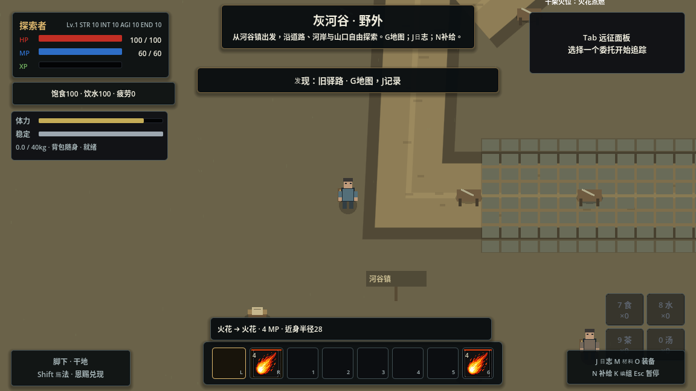
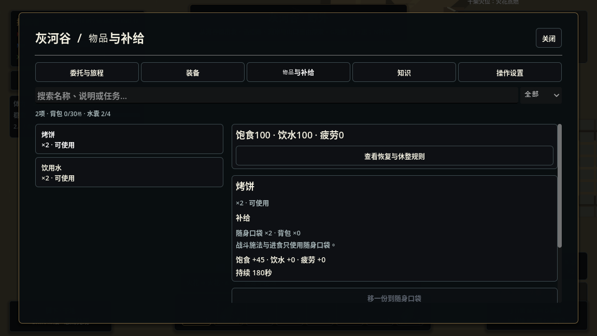

# RPG 基座：所有权、角色组合与系统联动

2026-11-06。当前实现优先解决后续扩展的结构问题；灰河谷是首个使用新规则的内容适配器。叙事与新增地图不属于本轮范围。

## 设计依据与取舍

本轮阅读了 Godot 4.6 官方文档源码，对应文档入口：

- [Scene organization](https://docs.godotengine.org/en/4.6/tutorials/best_practices/scene_organization.html)：场景尽量自包含；外部依赖由上层注入；信号表示已经发生的事，Callable 用于提出行为请求。
- [Node alternatives](https://docs.godotengine.org/en/4.6/tutorials/best_practices/node_alternatives.html)：需要场景生命周期、物理或绘制的对象使用 Node；定义使用 Resource；无需场景树的运行时值与服务使用 RefCounted。
- [Godot interfaces](https://docs.godotengine.org/en/4.6/tutorials/best_practices/godot_interfaces.html)：缓存的 Resource 会被共享，角色状态不能写入共享定义。
- [Project organization](https://docs.godotengine.org/en/4.6/tutorials/best_practices/project_organization.html)：按用途组织资源，场景及配套代码集中维护。

采用 Godot 的场景组合与显式依赖，不引入通用 ECS 框架。参考《上古卷轴5》的共同角色规则、物品所有权和世界状态持续性；参考 Outward 的体力承诺、稳定性、有限随身物资与放包减负。这里落地的是这些系统间的因果关系，没有复制其完整规模或数值平衡。

## 所有权与装配

```text
CampaignGame / GrayriverGame（入口与内容适配）
├── CampaignSession（本次战役的服务和持久快照）
│   ├── InventoryService / GameplayFacts / RelationService
│   ├── RegionContext（根、generation、RegionNavigation）
│   └── actor_records（可保存的值）/ actors（WeakRef 注册表）
├── World
│   └── 活动区域：角色、交互、遗骸、放下的背包
└── Interface
    └── ExpeditionScreen / HUD / 输入设置
```

`MVPGame` 是旧场景入口名称的薄适配器。通用探索编排改为 `CampaignGame`；章节分支不进入共用角色和物品规则。旧房间模式通过注入 `world_provider` 取得房间作用域。

每个参与角色都有 `ActorContext`，包含身份、规则、区域、物品、关系、事实及能力回调。`ActorComponents.tscn` 组合体力、稳定性与物理动作执行器。输入和 AI 提出同一种 `Action`，动作执行器决定是否接受、何时命中和怎样消费资源。`SharedActor.tscn` 可独立实例化；`ServiceNPC` 通过继承这个场景增加服务和日程，而不是另建一套装备、受击或饮食逻辑。玩家与既有敌人的场景保留原有表现/法术组件，绑定同一组基础组件。

`RulesetDefinition` 描述本场景是否启用物理库存、新操作、战术战斗与野外换装，以及容量、负重和基地范围。通用代码不通过 `GrayriverGame`、`MVPGame` 或 `current_scene` 选择规则。`GameRuntime` 仍负责原有法术、世界模拟和存档设施；本轮没有把所有既有适配器重写为无全局引用的纯域模型。

## 物品的唯一来源

| 类型 | 保存什么 | 谁修改 |
|---|---|---|
| `ItemData / EquipmentData` | 名称、重量、堆叠与战斗定义 | 内容作者 |
| `ItemInstance` | UID、定义 ID、数量、实例属性 | InventoryService |
| 容器 | 所有者、类型、容量、revision、物品及穿戴槽 | InventoryService |
| UI/旧适配器 | 只读列表、统计与兼容投影 | 从库存查询 |

每个角色拥有 pocket、pack、gear 容器。装备一件、移动一件或取走遗骸装备，移动的是同一 UID；同名的两件武器是两个实例。可堆叠物资允许合并、拆分，合并后的堆保留目标堆身份。按 UID 的内部索引用于定位，公开 `item()` 和 `entries()` 返回值副本。

`TransferPlan` 捕获源、目标 revision；提交时重新验证数量、容量及水囊限制。过期计划不能重复执行。交易在临时状态中先移出双方支付，再接收双方所得，全部通过后一次提交；满容器可以交换等量装备。失败不发布已提交事实。制造、回收、烹饪、采集也检查实际产出是否装得下，失败回滚材料。尸体与剩余库存不会从模板补齐。

口袋用于战斗施法材料和进食，背包是负重与携带空间。补给页可在安全且没有动作承诺时逐份整理。B 放下背包后，其物品不再计入可用随身物资或负重；区域记录位置，返回后 E 拾回原容器。水在同一角色的两个容器间移动不会再次占用水囊额度。

`CastingSupplies.amounts`、旧 `Inventory` 网格和 `EquipmentManager` 是兼容适配器，绑定后读写真实容器。旧装备件数、材料字典和遗骸余量仍保留存档投影，以服务既有界面和迁移；它们不能作为新的第二套库存使用。低层内部容器数据只供领域及迁移适配器使用。

## 战斗、饮食与成长

普通攻击由前摇、有效窗口、后摇组成。默认消耗12体力；重击使用武器 AttackProfile 的派生参数，体力/冲击翻倍、伤害1.5倍、前摇和后摇更长。一次挥击对同一目标只命中一次，命中仍经 `CombatExecutor.report_hit`，受墙体、距离和扇形限制。大物理步长越过有效窗口也只结算一次。

V 格挡要求实际持有武器或盾、检查正面方向、消耗体力；盾与武器的吸收和费用不同，体力不足会破防。稳定性不足产生硬直/倒地及恢复保护。空格闪避消耗20体力，仅中段拒绝直接命中；环境伤害和已有 DOT 不因此消失。Alt 冲刺持续消费体力；负重影响动作费用和速度。短输入缓存只保存玩家实际提出的单个动作，不自动生成连段或组合。

玩家进食继续使用既有现场作业的站定、受伤/移动中断规则。NPC 使用 `ActorItemUse`，同样消费口袋里的实物、使用 `SurvivalNeeds` 和 `NeedsRecovery` 获得恢复；取消或未完成时不消费。饮水、饱食和疲劳影响恢复，体力恢复也读取这些需求。低体力敌人可以选择现有口袋饮水、格挡和拉开距离。

近战命中、格挡与制造的已提交事实接入原有熟练度/经验流程。一次攻击 family 去重，练习角色不能借此获得成长或永久战利品。近战、防御、制造熟练度对相应体力/作业费用提供有上限的小幅改善；没有新增整棵技能树。

## 世界与生命周期

关系按个人覆盖、阵营默认、同阵营友好、否则中立查询。对正常角色造成有效伤害会改变其对攻击者的态度；交涉和既有章节结果通过适配器更新关系。训练师是可受伤、持有物品的角色，06:00—22:00 在工作点提供服务，夜间走向休息点；敌对时停止服务。

`RegionNavigation` 从实际障碍建立 AStarGrid2D，限制斜角穿墙；灰河谷适配器额外标记湖面和损坏的桥，修桥后更新通路。它服务追击和日程移动，未实现多人动态避让或流式开放世界导航。

`WorldCondition` 可按 claim、清场、库存、关系或知识定义委托条件。`QuestObjective` 只保存条件定义，`QuestRuntime` 独占进度；同一个 Resource 可被两个任务运行实例安全共享。

离区前保存角色位置、生命、法力、体力、需求与库存；清理动作、回调和临时角色引用，再推进 generation 并卸载旧根。临时练习容器与关系不进入永久库存。节点引用、Callable、任务进度定义对象都不写入存档。

## 存档与内容扩展

文件版本为4，战役 foundation 区块 schema 为1。v1—v3 仍走原有逐级迁移，缺失 foundation 时从旧库存/件数/穿戴/剩余物资建立实例；已有 foundation 时以其为准，不再从模板灌入。字段类型、UID 唯一性/分配器、堆叠上限、装备槽、已知物品和区域引用会在恢复前校验；无效快照不先清空正常库存。文件损坏、备份和未来版本保护由原 `SaveRepository` 处理。

新增物品加入 `content/foundation/items.tres`，武器可附 `AttackProfile`；新增角色通过 `ActorCharacterData` 和共用场景装配，服务配置由内容适配器注入。新增配方继续使用现有 `CraftingRecipe`，不要另造字符串执行脚本或在 UI 修改库存。入口需要接入 Session 的快照和区域离开协议，而不是仅实例化外观。

## 验证入口

- `python tools/run_tests.py --suite all --jobs 3`：既有回归与 foundation_inventory/combat/systems。
- 新回归覆盖装备 UID、重复计划、满容器交易、失败回滚、合并堆叠、水囊整理、只读查询、共用战斗、NPC 日程/饮水、20次区域切换、放包回收、NPC 伤势装备持续、任务 Resource 隔离及独立场景装配。
- `tools/capture_rpg_foundation.gd`：开启正常模拟和 AI，实际 InputMap 移动与重击输入，验证体力消费及敌人响应。截图中的位置安排和补给展示是受控布置，不代表自然通关或平衡验收。
- `tools/capture_frontier_expedition.gd`：1152×648 与960×600界面、真实鼠标作业按钮检查；该旧截图夹具会冻结模拟和敌人，不能作为正常战斗证明。

图形云验证使用 Mesa llvmpipe 和 Xorg dummy。驱动不支持切换 VSync 的警告是环境限制；不据此承诺实际设备帧率。后续重点是正常游玩中的数值调校、动画与手感、更多可组合服务及长期存档压力验证；本轮没有完整犯罪/司法、随机词缀、联机、3D或新增大型叙事。



