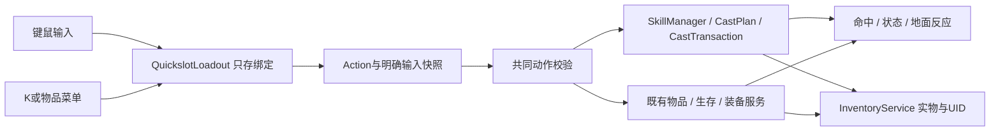

# 施法体系审查与统一快捷槽

2026-11-07，审查起点 `09f963c`。重点是让少量动作、物品和现场条件形成选择，同时控制管理负担。本轮修正快捷槽与输入架构，保留现有地图、敌人、材料配方和战斗数值；没有靠新增技能数量充实体系。

## 审查结论

当前体系已有值得保留的共同执行链：真实库存、明确来源、现场准备、CastPlan预览/提交、敌我共同命中及地面反应。主要问题在玩家访问这些能力的方式：技能槽与物品栏分开保存；E被做成1的别名；同动作多个槽共享全局选材；界面把旧结果定义与可装备基础动作放在一起。后两项会使增加材料效果变成频繁切菜单、记住额外配置的负担。

快捷栏现统一为 **Q/E/R与1—0共13个独立槽**，全部可绑定动作或物品。没有默认按键别名，Z/X可自行改键。屏幕中间九槽与右侧四个按钮只是布局分组，不是两种权限或两份编组状态。左键攻击、右键格挡、F交互、T仅在遗骸菜单尽量取物、Space闪避、Alt冲刺、Shift显式强化继续保留。

本轮没有删除历史能力：旧凝神与调谐的动作ID本来就是`focus`，旧汲魂与汲取共用`soul_harvest`。这属于显示名称和Resource兼容，不能误判成四个可装备基础动作。旧房间模式及其升级验证继续保留；当前材料操作模式的K页只列可编组入口，组合结果从资料/预览查看。

## 实际规模与内容边界

[自动生成清单](review/SPELL_INVENTORY.md)及[完整JSON](review/spell_inventory.json)由`tools/audit_spell_system.gd`读取灰河谷目录、操作资源、物品用途、Buff、元素、命中与地面规则生成。新增内容后可重新生成，避免手写清单逐渐失真。

| 项目 | 当前规模 | 含义 |
|---|---:|---|
| 玩家基础动作 | 11 | 火花、震荡、水引及8类材料操作；不是49个技能 |
| 材料操作 | 8 | 铭刻、喷洒、调谐、汲取、聚能投射、塑形、移形、引导 |
| 介质/效果样式 | 49 | 5/5/9/6/9/11/3/1，分别归上述8类操作 |
| 条件法术规则 | 37 | 24条章节规则与13条操作/储能规则，按知识和现场条件生效 |
| 修饰材料 | 7 | 与主介质区分；同一实物可能承担不同用途 |
| 有使用动作的物品 | 10 | 2种抹布、3种投掷瓶、5种喷剂；另有5种饮食定义 |
| 制造 | 20+4 | 20条材料/物品制造配方；4条烹饪/净水配方 |
| 参与施法制造链的物品ID | 26 | 含原料、介质、成品与饮用水，不能称作26种新施法材料 |
| Buff定义中的状态ID | 28 | 包括正面、负面、准备与储能；同ID的来源变体不能算可叠加状态 |
| 命中/地面反应 | 9/16 | 独立于37条施法条件规则，共用战斗与表面执行链 |
| 地面状态 | 8 | 干地、水、冰、油、火、电水、蒸汽、毒地 |

JSON中的82个effect定义记录包括运行时介质变体、旧结果和升级所引用的定义，不等于82个可装备技能，也不证明82种独立战术。清单是资源引用盘点，实际进入流程和操作覆盖分别由集成测试验证。

## 基础动作的分工

| 动作 | 基础费用/输入 | 玩家选择与用途 |
|---|---|---|
| 火花 | 4MP，普通施放 | 近身火焰工具；在已有法阵或准备状态下触发投射/组合 |
| 震荡 | 3MP，普通施放 | 近身冲击、破冰、触发阵爆；不是另一发通用远程弹 |
| 水引 | 5MP，选落点 | 铺临时水、清洗和改变地面；不制造可永久携带的饮用水 |
| 铭刻 | 8MP，站定准备，8秒共同冷却 | 凝能阵无材料、1次充能；其他阵消费实物、2次充能；之后亲手触发 |
| 喷洒 | 每0.5秒基础2MP与1剂，按住/松开停止 | 前方120、60°锥形；近距持续暴露、细分剂量、移动受限；固定瓶空即停 |
| 调谐 | 基础4MP，普通施放 | 纯粹凝神、印记、护盾或明确借某种阵；不能缺阵时偷偷改用纯粹凝神 |
| 汲取 | 基础4MP，普通施放 | 真实残魂/自身法阵充能换临时储能；45秒、基础3层、类型互斥，不产永久物资 |
| 聚能投射 | 基础18MP，按住蓄力、松开，5秒共同冷却 | 9种投射样式；真实材料与明确法阵来源，基础总价18—32MP |
| 塑形 | 基础24MP，0.8秒准备、8秒共同冷却 | 11种区域/临时构体/防护样式，基础总价24—44MP；详细结果必须写清位置、寿命与作用对象 |
| 移形 | 基础18MP，6秒共同冷却 | 3种移动用途，基础总价18—22MP；真实材料与凝能阵，受物理碰撞约束 |
| 引导介质 | 每0.4秒结算，按住/松开停止 | 当前为冰风暴；12MP/秒累计取整、每脉冲霜盐1份；前方范围压制，与近身喷剂不同 |

表中费用是定义基础值，最终以同一CastPlan预览为准。属性、疲劳、装备、恩赐和现场多个相容结果可能改变总价。多个槽装备同一操作继续共享操作冷却，不能通过换键或换材料绕过。

涂附与投掷继续属于物品：涂附消费抹布，附着具体武器UID；投掷整瓶并支付体力，适合远距一次投送。喷剂快捷项只是把“喷洒+这瓶介质”包装成可访问的请求，仍检查是否掌握喷洒，并逐剂支付MP和实物，没有新增免费物品执行链。

## 材料、组合、Buff与效果怎样组织

材料分为原料、主介质、可选修饰和成品物品。炭屑/树液/晶砂/布料/清水进入制造；火石、霜盐、雷晶粉、守护粉等决定某些操作的主结果；铭刻灰、树脂、霜盐、雷晶粉、回响墨、毒性萃取、守护粉也可在允许的结果上作额外修饰。主介质和修饰不是二选一的同一设置：K固定来源时分别显示，额外修饰默认不添加。

组合分三层，界面和目录不混称为“配方”：

- **准备与施法**：法阵、印记、护盾、储能、地面与基础动作得到37条受条件约束的结果。玩家每次自己准备和触发；站在多阵重叠处表示主动接受相容结果及其总费用。
- **命中反应**：融化、蒸发、毒燃、深冻、传导、过载、蒸汽爆破、暗蚀、碎冰等9条规则，读取命中标签与目标状态，经过同一命中边界。
- **地面反应**：油遇火、水结冰、水蒸发、电水传播、毒地清洗等16条状态转换，读取真实地面与范围；制造配方只改变库存，不属于这三类战斗组合。

状态也分清职责：

| 状态族 | 当前成员/用途 | 保持简单的约束 |
|---|---|---|
| 调谐增益 | 凝神、余烬战意、霜行、雷息、清明、流息、毒契 | 对应来源赋予持续收益；适配时可用Shift兑现，互斥组按实际Buff定义处理 |
| 施法准备 | 回响印记、共鸣护盾 | 有限寿命与版本；使用或兑现后失去原准备收益，不能藏成永久被动 |
| 储能 | 蕴魂与火/霜/雷/凝能/守护蕴能 | 当前汲取变体同属stored_energy互斥组；层数、来源、消耗明确，不与永久库存混用 |
| 防护/恢复/移动结果 | 冰霜护盾、辉光圣盾、先祖护佑、回响复苏、暗影步 | 都是现有操作结果，保留具体时长、治疗、属性贡献和代价，不再额外增加对应基础技能 |
| 接触/环境状态 | 燃烧、潮湿、冻结、中毒、感电、麻痹、冲洗、蒸汽庇护 | 读取实际命中与地面；同名状态不通过重复物品无限叠强；麻痹有控制恢复间隔 |
| 饮食与武器涂层 | 食物/饮水/茶计时，火/毒抹布 | 分别归生存需求和具体武器实例；不为统一显示而强塞进BuffManager |

完整效果、数值、互斥组和来源变体见自动清单。装备的持久属性贡献、食品计时与物品涂层各有真实生命周期，保存和暂停规则不能因为共用快捷栏而被改写。

## 本轮解决的架构问题

| 问题 | 影响 | 落实 |
|---|---|---|
| E/1别名及技能专用槽 | 无法独立编组近手动作与物品 | Q/E/R和1—0独立，13槽同一模型 |
| SkillManager与Session.belt各自保存编组 | 增加一种快捷项就要改两套输入、UI和存档 | `QuickslotLoadout`独占绑定；SkillManager旧API、Session.belt只作适配/查询投影；新档不再写belt |
| 同动作多槽共享M全局选择 | 快捷键不同但结果相同，战斗中反复开菜单 | K可按槽固定主介质与可选修饰；未固定时明确跟随M，固定槽不读其他槽/global的选材 |
| 按SkillData缓存预览 | 同一动作的两个固定来源可能显示同一结果 | UI缓存加入该槽选择；接受准备、重校验、引导和执行使用同一来源快照 |
| 重绑时旧按住动作仍可能释放 | 新旧来源混用或错误支付 | 槽位版本重验，换槽取消相应蓄力/投掷/喷洒；旧松键不使用新物品；失焦取消不确认 |
| 进食被现场作业与通用动作重复计时 | 取消后仍短暂拒绝下一动作 | 玩家进食由现场作业拥有计时；NPC既有物品计时路径保留 |
| 学习时只检查技能实例是否为空 | 物品槽被误当空槽，可能自动覆盖玩家编组 | 自动填槽检查完整绑定；已有物品与固定配置保留 |
| K混列旧组合结果和入口 | 玩家需要辨认能否编组、是否还要另选来源 | 当前材料模式K只列基础动作；介质作为动作内选项，物品独立页选择 |
| 同帧按下/松开 | 可能重复施法或吞掉快速使用 | 根据输入模式归并：快速技能/普通物品一次，投掷保留瞄准与确认，旧松键模式保留完整快照 |

Godot职责遵循[轻量对象](https://docs.godotengine.org/en/4.6/tutorials/best_practices/node_alternatives.html)与[场景组合/依赖注入](https://docs.godotengine.org/en/4.6/tutorials/best_practices/scene_organization.html)：绑定是RefCounted运行时值；可编辑动作/介质/用途仍是Resource；输入、持续喷洒和投掷仍由需要生命周期的Node处理。没有增加Autoload、ECS、组合脚本语言或新的库存权威。

存档v7写入统一快捷槽，继续读取v1—v6。旧Q/R、数字技能及升级保留；旧四格belt导入7—0一次。E新增槽保持空，不复制1的内容、不额外解锁或发物资。明确清空的槽重进仍为空。具体瓶/装备UID可跨档保留；失去实物时显示不可用，不自动找另一件。K固定的静态介质方案可保存；M本次选择、现场来源节点、临时储能、蓄力、引导、法阵与瞄准不恢复。

## 后续复杂度与扩展约束

1. 新化学效果优先增加介质或物品用途定义；只有操作节奏、投送几何或生命周期有实质差异才增加基础动作。不要为每个元素、状态或旧技能名新增一键入口。
2. 先展示动作、主来源、总费用、缺少条件和结果；额外修饰、恩赐消耗与装备借阵放到明确的二级说明。当前不要求玩家一次理解所有49种样式。
3. 保留投掷的远距整瓶承诺、喷洒的近距持续暴露、聚能投射的法阵准备、塑形的固定结果与移形的站位价值。新增效果要证明用途差异，不能只改颜色与伤害。
4. `SpellPayloadData.effect`目前允许使用既有SkillData结果蓝图，包含几何与Buff，而非纯化学数据。它是兼容旧能力的扩展点，不能据类注释误以为任何效果都只由材料数值决定。新增结果仍走既有执行器；暂不为潜在需求再抽象一套通用图语言。
5. 强化、借阵、储能和印记同时参与时，优先保证总费用与失败原因可解释；不要用自动补条件来掩盖复杂度。配置好的快捷槽只执行一个动作，不是一键准备链。

仍需验证的设计风险：

- **引导经济**：当前冰风暴每秒消耗2.5份霜盐和基础12MP，与瓶装喷剂的单位成本差异很大。现有能力执行测试不能证明这一价格有长期使用价值。下一轮应沿现有资源预算做同档战斗与采集成本比较，再决定调整剂量或成本。
- **塑形范围**：11个样式横跨区域、构体和自身防护，名称抽象较宽。现阶段用具体结果说明与按槽固定选择降低负担；暂不机械拆成更多技能。后续若出现大量同类样式，再依据空间行为划分定义，不能仅按旧技能名拆分。
- **水引与清水喷剂**：前者用MP制造临时水域，后者用实物在近距锥形清洗；两者没有制造永久饮用水的通路，但战术价值是否足够分化仍需多样本场景。
- **多条件叠加**：多阵、修饰、恩赐、临时储能能增加选择，也会放大价格与预览信息。继续要求手动站位和显式消费，并对代表性组合逐项测收益；不由“组合数很多”推导平衡完成。

## 验证范围

`test_unified_quickslots`以真实键鼠事件检查E技能/1食物、鼠标绑定、具体装备与脱战限制、同动作两种固定阵型/共享冷却、重绑后的旧松键、半瓶喷剂耗尽、涂附、7号槽放技能、混合绑定保存重进及真实v6档一次迁移。正常AI与模拟保留，但位置、知识和物资是受控夹具；玩家再生固定以核对费用。它证明请求、资源与持久化边界，不是自然通关或人体工学、战斗平衡结论。

原有全局鼠标输入、格挡、蓄力取消、界面焦点、预览缓存、技能升级和库存回归继续执行。图形与最终干净提交归档结果记录于[本轮验证](validation/unified_quickslots.json)。GitHub Actions保持停用。
