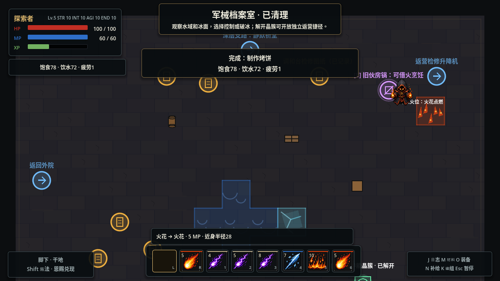
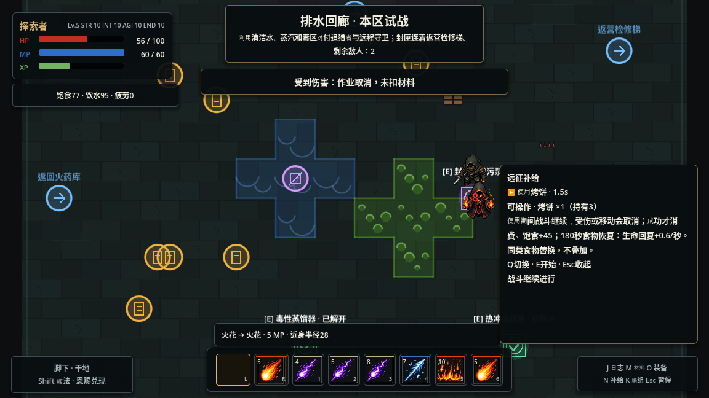

# 远征生存第一轮：饮食、饮水与休整

2026-11-06。以 Outward 的远征准备与途中应变为方向，在已有九区域和四元素玩法上落地循环。新增两类食材、三种食物/茶、两种水质、四项烹饪配方、七个场景补给点及三份记录；原有11动作、24法术组合、7种施法材料、7项施法材料制造配方、4件装备保持。烹饪配方与法术组合规则分别管理。

## 需求与恢复

N查看补给与当前效果，HUD显示饱食、饮水和疲劳。三项范围0—100。采用模拟运行时间，菜单暂停与离线不推进；时间流逝不会直接造成饥渴伤害。

| 机制 | 首轮常量 |
|---|---|
| 饱食 | 野外每15秒下降1；≤20时生命自然回复×0.35 |
| 饮水 | 野外每10秒下降1；≤20时法力自然回复×0.35 |
| 疲劳 | 野外每秒+0.04；每提交1 MP +0.06，近战+0.12，闪避+0.5 |
| 困倦/疲惫 | 疲劳≥60准备×1.15，≥85准备×1.25且两种自然回复再×0.5 |
| 耐力 | 有效耐力超过10后每点降低2%需求消耗和疲劳积累，最多30% |
| 营地 | 需求消耗为野外四分之一，不积累时间疲劳；动作仍有相应消耗 |

准备倍率与原敏捷、装备修正相乘。疲劳跨档时旧施法计划重新校验并取消，费用不泄漏。基本近战、闪避、必要返回通路不增加新的体力或食材门槛。

生命/法力仍由原组件结算，生存只提供自然回复倍率和加值，保留受伤/施法后的回复延迟。水路魔力导流的5 MP/秒仍然有效，休整不会把它重置成3。主动治疗、技能回复沿用原规则。

## 补给与制作

| 补给 | 使用时间 | 需求变化 | 持续收益 |
|---|---:|---|---|
| 烤饼 | 1.5秒 | 饱食+45 | 180秒生命自然回复+0.6/秒 |
| 苦叶炖汤 | 1.5秒 | 饱食+35、饮水+20、疲劳-8 | 240秒生命+0.4/秒、法力+0.5/秒 |
| 饮用水 | 1秒 | 饮水+40 | 120秒法力自然回复+0.5/秒 |
| 醒神茶 | 0.5秒 | 饮水+25、疲劳-15 | 解除当前中毒；150秒法力回复+1/秒 |
| 未净化水 | 1秒 | 饮水+25 | 中毒5秒，每秒基础3点，不随饮用者智力增强；没有清水恢复收益 |

烤饼与炖汤占同一食物位置，互相替换。饮水与茶各有独立计时；重复同类刷新完整时长，不累计、不无限叠加，不作为Shift可消费的元素恩赐。剩余时间和需求跨区、存档保留。茶不赋予持续毒免疫，之后仍可能再次被污染。

- 烤饼：谷粮1 → 烤饼1。
- 醒神茶：苦叶1＋饮用水1 → 茶1，需档案室伙房笔记。
- 炖汤：烤饼1＋苦叶1＋饮用水1 → 炖汤1，需回廊食谱。
- 过滤煮沸：未净化水1＋炭屑1 → 饮用水1；炭屑作为滤材仍需消费。

营地炉灶常燃。野外锅无火时，以上每份额外需要炭屑1作为燃料；先用火花点燃锅旁干柴，可省这份燃料。火源在准备中熄灭、到期或被水影响导致费用变化时取消，不能偷偷加收。使用现有真实地面反应，包括火焰蔓延；应站在安全格、锅的80交互范围内操作。档案室锅与干柴分别位于安全格和火位，火位标记与检测位置一致。

物品存入已有行囊事务，水袋上限为饮用水与未净化水合计4份。预览不扣库存，制作与使用在完成时原子支付。烹饪产物不能被配置为施法材料，也不进入原七项施法材料回收配方。

## 世界、探索和休整

- 营地西侧一次性口粮袋：烤饼2、谷粮3、苦叶2、饮用水4；新旧存档均可读取，不能重复领奖。
- 营地井提供清水，炉灶提供制作；普通临时魔法水面不能装成饮用水，身体洗毒与水源净化分别判断。
- 档案室有野外锅、谷粮储藏和醒神茶笔记；回廊有苦叶、取水口和炖汤笔记；机房有检修水嘴。
- 谷粮、苦叶每处采集2份，采后240秒模拟时间再生。冷却跨区、读档、死亡和遭遇重置保留，休整不会立即刷新。
- 水源冻结、导电、燃烧、蒸汽或油污染时不能取水；毒污染产生未净化水。普通火焰融冰不净化水质。回廊排污泵完成后，原取水口永久改善为清水，但再次受到实际污染时仍会变浑。

回营不自动补满生命和法力，篝火E选择：

| 休整 | 时间 | 结果与代价 |
|---|---:|---|
| 短休 | 3秒 | 生命+40、法力+30、疲劳-25；饱食-5、饮水-10 |
| 充分休整 | 6秒 | 恢复生命法力、疲劳归零；饱食-20、饮水-25 |
| 免费粗食 | 2秒 | 饱食/饮水至少60；不发库存、不赋予食物恢复收益、不恢复疲劳 |

吃喝、取水、采集、烹饪和休整使用同一现场作业机制。N可查看配置，点击使用后退出暂停菜单并进入实际作业；E/Q观察选择不暂停战斗。移动、施法、受伤、切区等仍会中断，未完成不扣料、不提前给效果。只有选中方法显示完整费用，避免四种烹饪方式挤满操作栏。

死亡返营恢复半数生命法力，饱食与饮水至少35、疲劳最多60；清除食物/饮水/茶收益，不补库存、不刷新采集，不增加不可逆惩罚。免费粗食与休整保证补给用尽仍可继续。

## 接口与兼容

`SurvivalNeeds`持有需求、三类食品收益和再生倒计时；`SurvivalService`连接现有时钟、行囊事务、现场作业和场景。`SurvivalStationData`是区域内固定补给点，参与障碍净空和内容校验，不新增事件编辑器。

新增进度字段 `survival_state`，包含需求、收益剩余时间、采集倒计时和当前HP/MP。缺失时按饱食/饮水100、疲劳0、无食品效果迁移；旧存档保留原知识、装备、任务与库存。新存档读档返回营地时恢复已保存生命法力，不能通过反复读档免费治疗。瞬时作业进度不保存。现有试验记录的起止配置附带生存快照，旧记录缺失字段仍可读。

## 验证与试玩

统一检查45项通过，包括原42项与新增 `survival_needs`、`survival_world`、`survival_rest`。覆盖十分钟模拟消耗与耐力差异、食物替换/刷新/过期、暂停、存档有限数值、四份水袋、原子支付和中断、真实火花点燃干柴、熄火回滚、安全烹饪位置、采集再生与跨区、水质/冻结/导电/修泵、休整代价、魔力导流、疲劳准备回滚、死亡与旧存档迁移。原死亡返营检查更新为新规则的半数生命，其余原验收保留。

桌面试玩使用正常100HP/60MP、四属性10的已通关旧存档和真实键鼠，观察脚本只读，不改角色、AI或资源：领取口粮、吃喝、井水补满、营地烤饼、野外火花借火烤饼、读笔记与制茶、充分休整均走通。借火一份烤饼仅消耗谷粮，炭屑13保持13；第一次踩入蔓延的燃烧格导致操作中断，物品未扣。之后在安全格完成。

回廊本区试战中，追猎者与远程敌人实际打断吃饼，烤饼3份保持3份，旧食物收益没有被免费刷新。受伤返营生命56保持56，充分休整后才恢复100，并支付饱食/饮水。保存75生命后结束进程、重新打开，仍为75，食品剩余时间也保留。

这轮验证基础循环和局部战斗交互。长路线的饥渴速度、食材再生、回复强度还需要更多正常试玩校准；温度、食物腐坏、负重、疾病体系和战斗体力条留待后续，不把本轮称为完整Outward生存模拟。

[桌面检查记录](playtests/survival_2026_11_06.json)保留实际角色、库存、受伤与中断结果。

