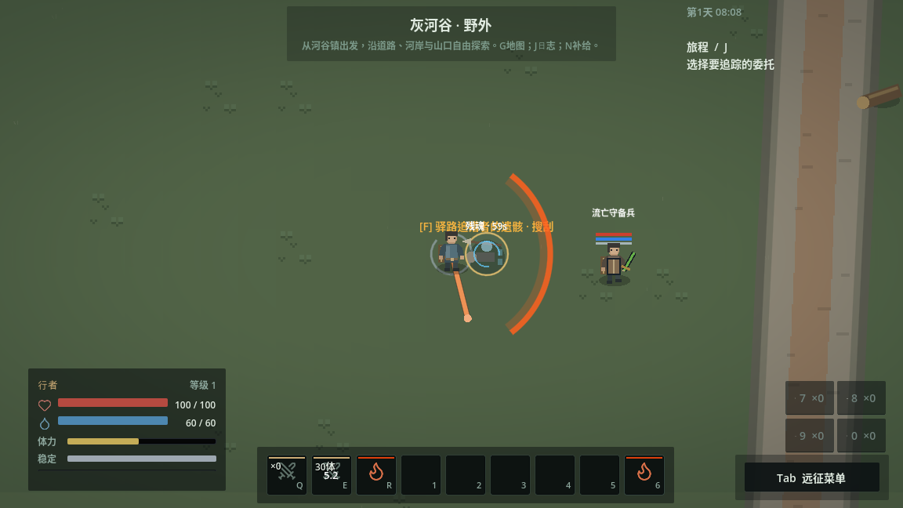

# 武器附魔与武技释放验收

2026-11-08 UTC。规则见[设计](WEAPON_ENCHANTMENT.md)。云端Godot4.6.3，Actions保持停用。

## 领域与输入

`weapon_enchantment`覆盖伤害分量、两击阈值、衰减/免疫/盾牌、DOT不重复附加伤害、不续满既有状态、六种近战材料形态、起手中断/换源、近战与波防重、墙后无伤害/积累/引油、轮廓裁切、施放者移动不改变格挡方向、箭/涂层共同提交、在途箭不被新涂层改写、主箭/扩散防重、实际存档重进、离区衰减及异常数值拒绝。物资/站位为机制夹具。

旧`item_actions`中“毒抹布第一击立即中毒”改为“第一击60积累、尚未中毒”；喷剂、投掷、真实拾取与原涂层持久性仍保留覆盖。

`enchantment_input`通过真实Q、左键、Shift+E完成涂附、两次命中与释放；Shift在挥出前已松开。前两次近战目标决策停用以验证阈值，波形面对原有守备兵正常AI/上限/资源。未直接调用施法或命中来模拟键鼠成功。

原生`/tmp/grayriver-first30/enchantment-native-input/runtime.log`通过：MP始终60，火抹布1份成为具体战杖60秒涂层；第一击积累50%，第二击燃烧，Shift+E挥出后涂层消失、产生前进火波。此正常AI样本守备兵HP60→43、体力84；不保证所有时机都命中。实际保存重进后同一武器UID存在，消耗的涂层没有恢复。

平台为Xorg dummy、Mesa llvmpipe、OpenGL兼容、1152×648；启动有一次驱动不支持更改VSync的警告，无脚本错误。已检查积累、计时、预警和波形截图；不作为目标设备性能或最终美术证明。

## 正常流程

正常新档`/tmp/grayriver-first30/enchantment-expedition/`完成读手册、补给、制火石、北路布阵/火球、实物战利品与返镇。首场游戏4.19秒、墙钟4.27秒，受伤0，消耗火石1和32 MP，MP60→28。

第39步背包点击出现`inventory_selection_moved`，未完成一次连续71步。没有改库存或强行选中节点；从本次游戏生成的返镇存档另开原生`/tmp/grayriver-first30/enchant-inventory-repro/`，同一真实鼠标操作正常装备短刀，再按余下原始输入完成出售、训练、K绑定E、武技交战、拾取和返镇保存。命令`/tmp/enchantment-expedition-resume.log`。因此这是分段正常流程，不能宣称连续首玩无交互失误。

第二场游戏2.62秒、墙钟2.66秒，受伤14，MP60→60；含中毒全程累计受伤29，返镇生命73。没有增发物资、冻结该路线AI、提高上限或重置遭遇。此流程检查旧闭环，新释放机制主要由上面的真实输入及正常AI局部样本证明。

## 独立进程重进

归档原生输入`/tmp/grayriver-first30/enchantment-archive-input/runtime.log`通过，与开发样本一致。另用其实际存档启动独立原生进程`/tmp/grayriver-first30/enchantment-archive-reentry/`：战杖UID `item.77`仍装备、无coating属性，火抹布已消费，E仍绑定横扫，MP60、动作idle；真实点击进入旅程并退出成功。无脚本错误，未从模板补回涂层。

## 提交归档

开发完整88/88通过，日志`/tmp/enchantment-work-all.log`、`/tmp/mygame-tests-j49reo6g/`；之后增加墙体裁切/来袭快照等边界，匹配5/5通过，日志`/tmp/mygame-tests-6txxwv73/`。最终代码提交`5c139e2a4715eebc79480022f3d6fe7a753a8b38`以`git archive`导出到`/tmp/mygame-enchantment-clean-wygdEm`，无`.godot`缓存。执行`python3 tools/run_tests.py --suite all --jobs 3 --timeout 120`：首次导入9.9秒通过，**88/88全部通过**，退出0，无runner诊断。总日志`/tmp/enchantment-cold-all.log`，分项日志与隔离存档`/tmp/mygame-tests-v9vhhvgx/`。同一归档的真实键鼠与独立原生进程重进也通过。随后只补充本验证文档；Actions未启用。

覆盖限制：当前为火/毒与四种现有武技的联动，机制夹具和正常AI局部样本不代表完整平衡；旧流程只分段完成，背包点击一次失败仍明确保留，不能宣称连续无误首玩或目标硬件性能已验收。

