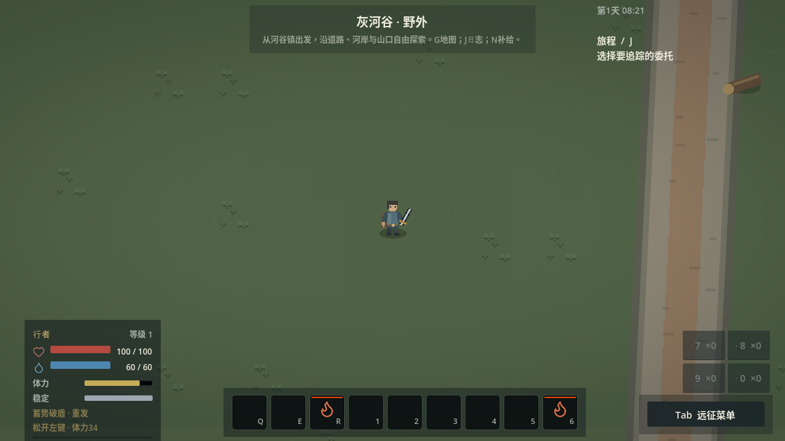
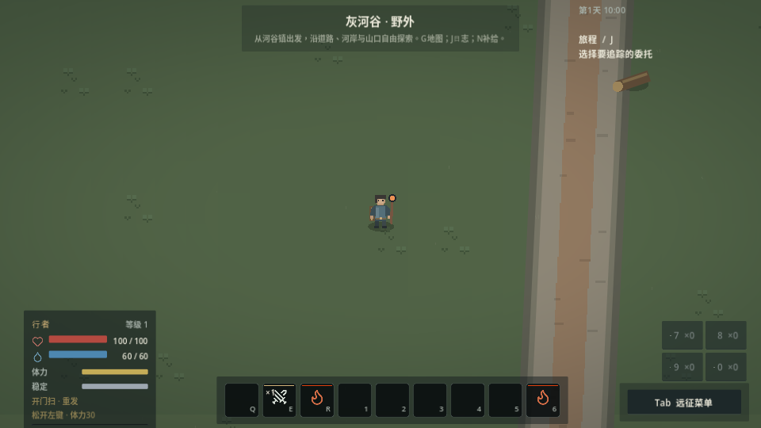

# 按住式武器操作验证

2026-11-09，云端Linux / Godot 4.6.3。玩法与测试源码提交：`75c1270`。操作与实现边界见[按住式武器操作](WEAPON_HOLD_INPUT.md)。

## 原生窗口

通过Xorg启动Godot Compatibility原生窗口，实际Godot鼠标/键盘事件驱动`weapon_hold_input`，隔离新档，恢复正常游戏模拟与所有敌人AI。装备、知识和远离敌人的测试位置由fixture提供，不等同自然开荒或真人手感评价。

`/tmp/grayriver-first30/hold-weapon-native-delivery/runtime.log`最终为PASS、Godot退出0；录像`weapon-response.mp4`为131.77秒。先用1152×648，再缩至960×540，检查蓄力提示位于视口内。云端驱动仅报告不支持切换VSync，无脚本或玩法错误；这份录像不用于证明目标设备帧率。

- 按下不出轻击，松开只出一次；同帧短按不丢输入。
- 四类武器分别通过轻→重路线，短按Ctrl+左键速发、长按重发。晚窗口开始准备后可释放同一路线；松开Ctrl不会把武技换回普通攻击。
- 真实E快捷槽使用抹布；Ctrl+Shift+左键按下后松开修饰键，仍在实际挥出时消耗同一武器涂层。
- 右键、菜单、2秒超时、换装、失衡、失焦通知、F5/F9取消旧手势；世界不暂停。测试中的失焦为Godot生命周期通知，不宣称覆盖全部桌面窗口管理器行为。

每种武器记录的是两套完整“轻→重→武技”，一套速发、一套重发。记录点包含自然体力恢复，因此下表不是静态费用或平衡比较。

| 武器 | 重发形式 | 记录时体力 | 口袋箭矢 | MP |
|---|---|---:|---:|---:|
| 刀剑 | 蓄势破盾 | 52.17 | 16 | 60 |
| 长矛 | 蓄势贯冲 | 45.67 | 16 | 60 |
| 战杖 | 蓄势震扫 | 47.67 | 16 | 60 |
| 弓 | 满弦穿射 | 67.33 | 10 | 60 |

弓两套路线总计六次实际离弦，恰好消耗六支箭；近战不扣箭，所有物理武技不扣MP。

## 领域与输入衔接

`weapon_hold`采用受控时钟和一个静止目标，验证全部八种重发Profile、0.319/0.320秒边界、起手抵扣只修改副本、费用重验与拒绝无支出。实际重发破盾命中使守卫体力由100降为0；使用共同CombatExecutor与格挡规则，无测试专用扣血入口。弓命中分支通过真实WeaponArrow确认，清理其他测试遗留箭以隔离命中来源。

`weapon_hold_handover_input`以真实输入验证取消未付款涂附、左键确认投掷只消耗一瓶且不发动攻击、喷洒转攻击保留已付剂量。该脚本的原生窗口复测同样PASS、Godot退出0，日志位于`/tmp/grayriver-first30/hold-weapon-native-handover/runtime.log`。`input_bindings`覆盖v6默认迁移、自定义武技/重击键保留、鼠标保留键与独立E/1。

## 干净归档回归

从提交`75c127060a6ed3ff99e9ce4a13c111b1d1cde14c`执行`git archive`，导出至`/tmp/mygame-hold-delivery-44eiho2w`，初始无`.godot`缓存，执行`python3 tools/run_tests.py --suite all --jobs 3`。首次导入通过，runner最终退出0，**113/113检查通过**；日志位于`/tmp/mygame-tests-rzabi1cl`。

后续提交仅补充本文、说明链接和两张原生截图，不改变已回归的玩法或测试源码。合并前复查远端main、保护规则及PR状态；GitHub Actions继续保持停用。
