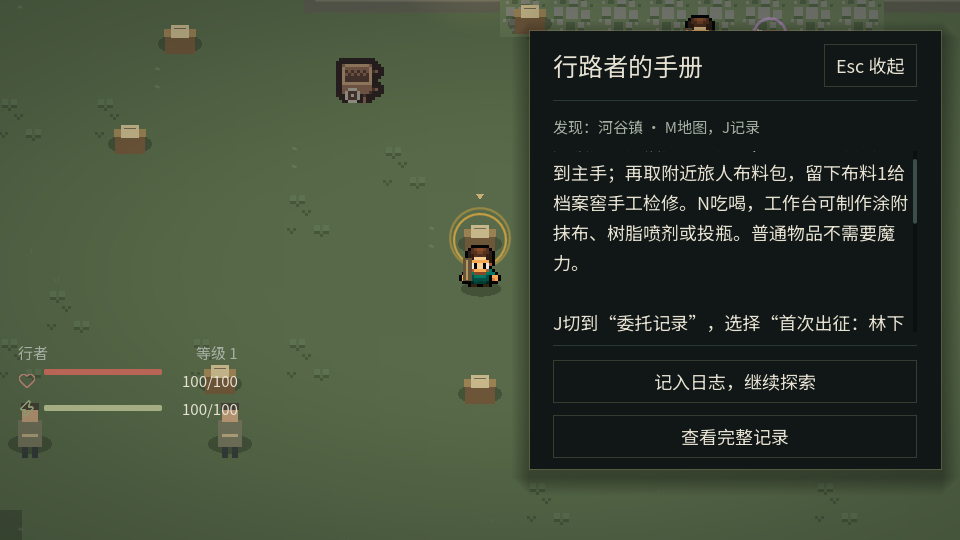
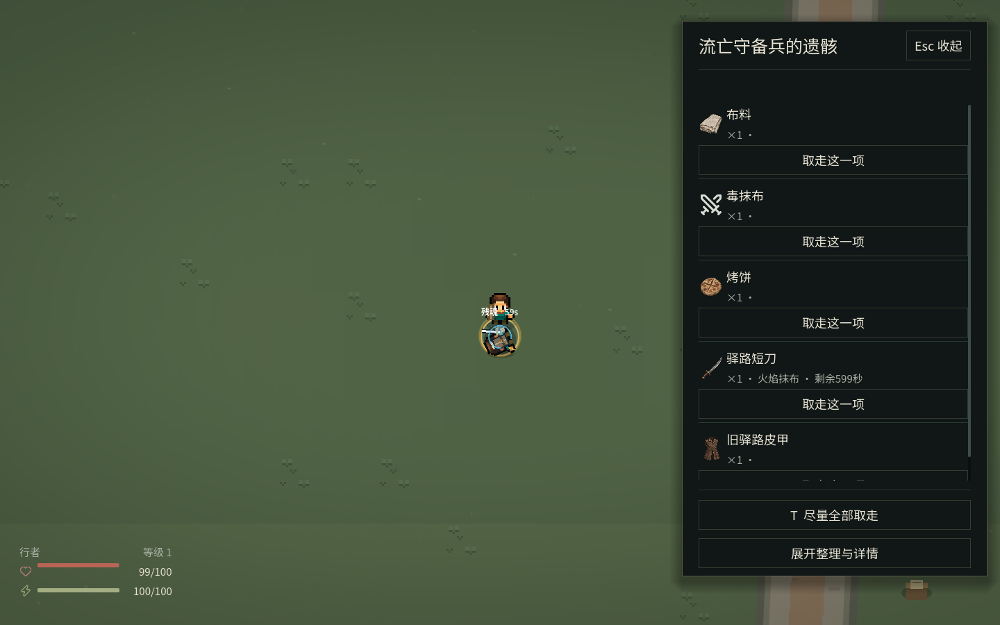
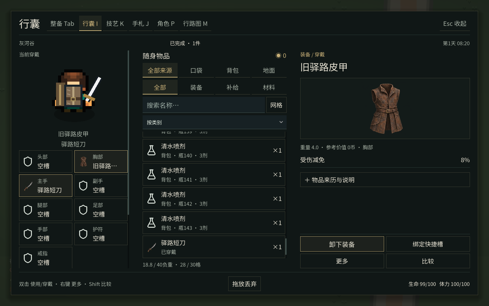
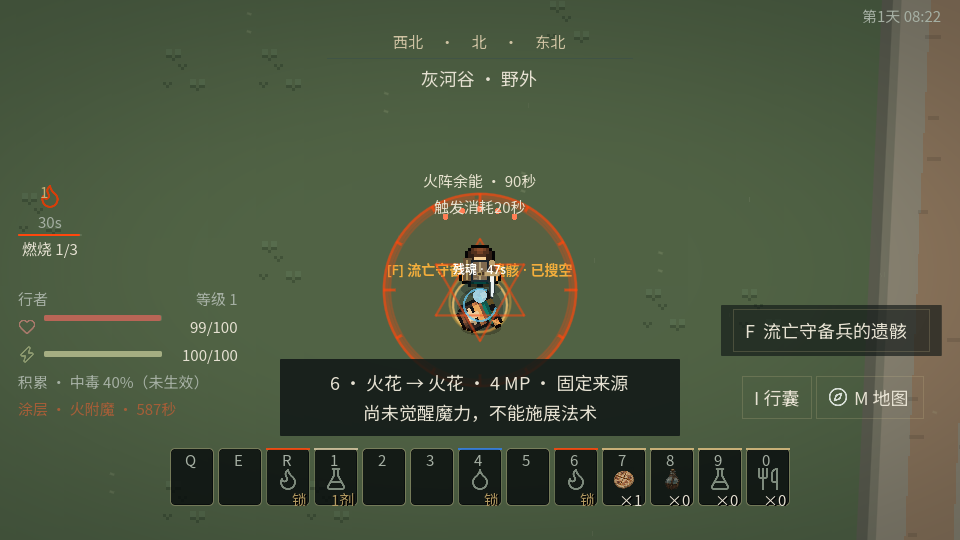

# 灰河谷：轻量交互、战斗反馈与物品美术样本

源码起点：`f2ea0f00b431e3af6b740d8de222ed44e6181633`。最终运行源码：`2dcfc32972e5933c9f76efd8fe4e9b88b3286b53`。后续证据提交只添加本目录，不改变游戏源码。完整范围、所有权与扩展方式见[设计与接入说明](../../IMMERSIVE_INSPECTION_AND_FEEDBACK.md)。

## 实际交付

1. 普通现场阅读、遗骸及地面拾取默认使用轻量侧栏。现场仍可见，AI、时间和伤害照常；受伤、来源失效、Esc或点外侧收起。抽屉打开时接管角色输入，不能边阅读边攻击；点击关闭也不会穿透为攻击。详细管理和重大决定保留原完整界面。
2. 快速搜取按真实UID显示剂量、涂层与余量。T尽量转移可携带部分，放不下的仍在原来源；专业部位明确展开要求，再由玩家开始原现场作业。界面不产生物品，不自动选择另一瓶或代替剥取。
3. 明确区分异常积累（未生效）、已经生效的状态、实际武器涂层和地面火阵余能。小屏幕状态区、角色数值、快捷栏与当前法术说明保持各自位置；附近交互提示避开法术说明。敌人仍受原距离/视线门控。
4. 16件现有物品接入同一张原创AI生成图集，小图/大图共用对应格。刀、矛、杖、弓、皮甲、盾、靴与常用生存材料覆盖代表性流程。穿戴、纸娃娃、遗骸和地面容器继续读实际实物，不由插画产生另一套装备状态。






## 测试中发现的原因与修正

- 涂层秒数进入列表结构比较，倒计时使同一UID的按钮反复销毁，导致按下与松开可能落在不同控件上。结构只比较稳定身份，余量/秒数就地刷新，并实际跨越计时后点击验证。
- 轻量抽屉沿用既有Modal而调整了内容，原焦点路径不能约束到新结构。使用现有导航辅助函数在输入所有权边界处理Tab/Shift+Tab；实际键盘验证焦点留在当前抽屉。
- HUD在窗口调整期间混用了尚未更新的局部坐标与新视口高度，生效状态图标能被推到画面之外。状态与资源区改用共同底部锚点及offset计算，并验证小窗实际可见区域，而不只比较根矩形。
- 可点击交互提示为避开法术说明而上移，实际盖住了近身与中距瞄准点；左键攻击打开了敌人观察。保留原附魔断言，通过原生截图定位后将鼠标入口收回右下窄列，按法术说明实际边界限制宽度；新增两种瞄准距离的断言，继续验证真实轻击积累、阈值触发与Ctrl+Shift元素释放。
- 无界面滚轮夹具先用push_input点击，再读取Input原生鼠标位置，两条坐标路径不一致。改为显式目标坐标并转换为窗口像素，保留小窗溢出与大窗不滚动断言。旧附魔夹具也改为共用缩放输入辅助函数；这一修正没有解决按钮覆盖，实际游戏问题仍按上一条处理。
- 小窗口切换时，提示排布跟随0.15秒目标查询刷新，可能落后于菜单的尺寸更新；原生截图等待较久时未显露。把可见提示布局移到每帧表现更新，目标/来源查询仍低频。保留小窗与宽窗的实际矩形不相交断言；完整回归的原失败记录保留在diagnostic-layout-all-results.json。
- 现场结果通知原来覆盖角色与侧栏内容。轻量模式使用固定消息行，暂时收起重复交互提示与不可操作的菜单入口，不隐藏真实生命和伤害。
- 旧阅读断言只读取RichTextLabel，遗漏新抽屉的Label；旧地面断言仍要求F打开完整行囊。更新展示读取与真实鼠标入口，保留简短/完整正文、不重复奖励、原瓶UID/剂量及AI伤害断言。
- 旧工作台输入夹具直接调用close后立刻查可见菜单，绕过关闭事件与布局时序。改为实际Esc事件后再继续原制造/支付断言，没有删除断言或改变费用规则。
- 美术登记CSV曾被Godot默认当作翻译表导入。登记放入有`.gdignore`的provenance目录，保留来源记录；运行时只导入真正图集与Resource。

诊断失败记录保留在`diagnostic-*.json`；它们解释迭代中发现的问题，不是最终结果。最终源码的图形结果与干净归档回归分别列于下方。

## 最终图形与输入验证

命令：

```sh
python3 -c "import tools.capture_ui as c; c.TESTS=('enchantment_input','immersive_ui_input','ui_vertical_input','ui_prototype_input'); raise SystemExit(c.main())" \
  --output /workspace/immersive-art-acceptance-native \
  --tests enchantment_input immersive_ui_input ui_vertical_input ui_prototype_input --display 95
```

四个原生图形输入脚本均退出0，无ERROR/SCRIPT ERROR：

| 脚本 | 断言 | 结果 |
|---|---:|---|
| immersive_ui_input | 47 | PASS |
| ui_vertical_input | 110 | PASS |
| ui_prototype_input | 478 | PASS |
| 三组UI合计 | 635 | PASS |
| enchantment_input | 原有附魔断言及两项瞄准点检查 | PASS |

覆盖960×540、960×720、1440×900和1920×1080窗口及125%文字；新侧栏与状态图另覆盖960×540/1440×900。实际F/T/Esc、鼠标点取、滚轮、Tab/Shift+Tab、装备、丢弃/拾回与冷重进；核对原物品UID、涂层截止时刻和容器剩余。完整旧界面回归包含行囊、绑定、物品详情、交易/制造与各管理页。

`targeted-results.json`另记录提交前内容、地图、GUT领域与操作工作流4/4通过。33项GUT全部通过，其中新增用例验证16格图集/图标一致及无效区域拒绝，不修改任何运行实例。

## 干净归档完整回归

首次干净归档83fe0a9完成全部162条结果（161项登记检查及首次导入），158通过、4失败、无跳过；原报告保留于diagnostic-initial-all-results.json。失败定位、修正与针对性复核见上。第二次ec02972完整回归161/162，通过新增不相交断言发现尺寸切换的排布时序问题，记录在diagnostic-layout-all-results.json。时序修正后的六项定向复核全部通过。

最终运行源码`2dcfc32972e5933c9f76efd8fe4e9b88b3286b53`重新导出无`.godot`缓存归档，完整回归**162/162通过**（161项登记检查及首次导入），无跳过、退出码0；共1723.514秒。33项GUT用例全部通过。运行期间源码冻结，未同时启动编辑器、导入或图形试玩。

```sh
git archive 2dcfc32972e5933c9f76efd8fe4e9b88b3286b53 | tar -x -C /workspace/immersive-art-acceptance-clean-2dcfc32
cd /workspace/immersive-art-acceptance-clean-2dcfc32
python3 tools/run_tests.py --suite all --jobs 2 --timeout 300 \
  --source-revision 2dcfc32972e5933c9f76efd8fe4e9b88b3286b53 \
  --report /workspace/immersive-art-acceptance-all.json
```

[最终完整结果](all-results.json)、[退出与耗时](all-exit.json)、[完整控制台](all-console.log)、[GUT记录](gut-domain.xml)。关键输入和首次导入原日志见`all-*.log`，原生图形结果见[native-results.json](native-results.json)。后续只添加证据，不再修改运行源码。

## 平台与覆盖限制

Linux云环境、Godot4.6.3、Xorg/X11原生窗口、gl_compatibility、Mesa llvmpipe软件渲染、Dummy音频。测试使用独立档案与正常AI/时钟，但为复现交互与构图控制了位置、原有守林兵的死亡、库存、积累和法阵。47项新夹具中的火阵能量消费由显式领域调用产生，不能视为自然施法/战术收益测量。原生附魔补充样本实际以0 MP完成附魔释放，原守林兵生命60→43、最终体力84，波被捕获、涂层已消费并在重进后保持消费；这是受控位置/装备样本，敌人可反应闪避，不是平衡结论。没有宣称自然通关、目标GPU帧率或声音验收。

角色穿戴仍为原有像素身体与共享几何装备层，补了样本纹样及配色，不是16套手绘逐方向动画或3D模型。插画仅覆盖16件样本，其余沿用既有图形。图集是AI生成输出，商业使用依据与原文件散列见[来源说明](../../../content/art/items/grayriver/SOURCE_NOTICE.md)，不标作CC0或人工绘制。

没有新增敌人、配方、地图、奖励或修改战斗数值。GitHub Actions保持停用。
