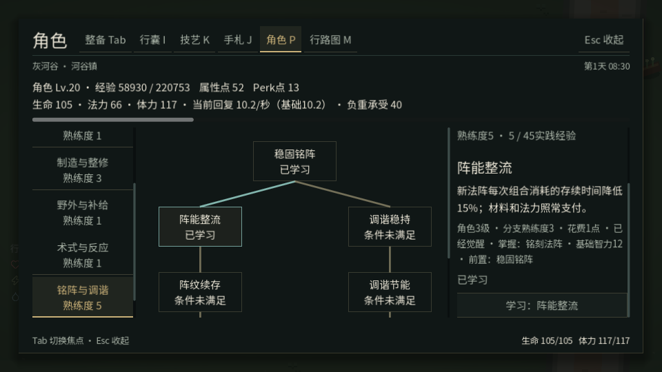
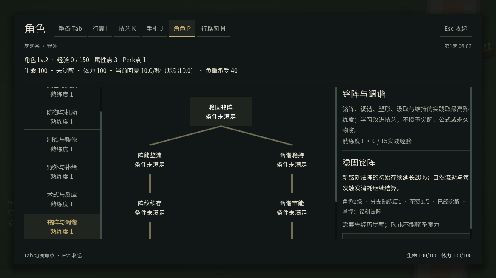
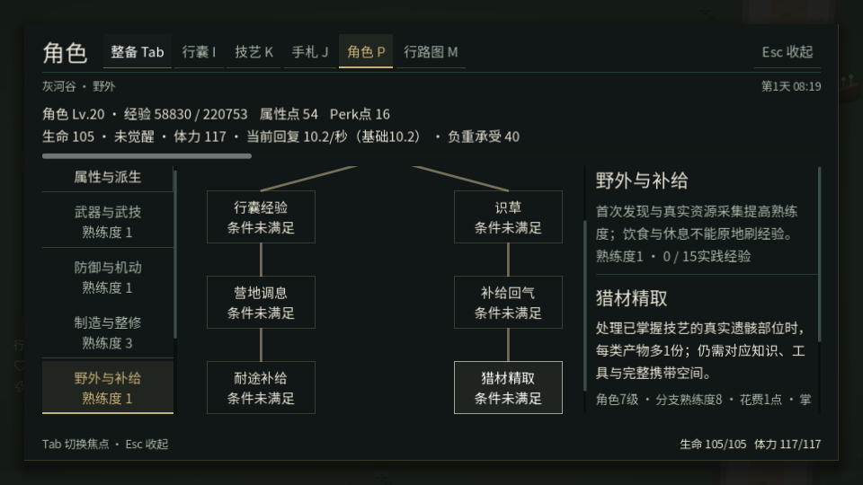
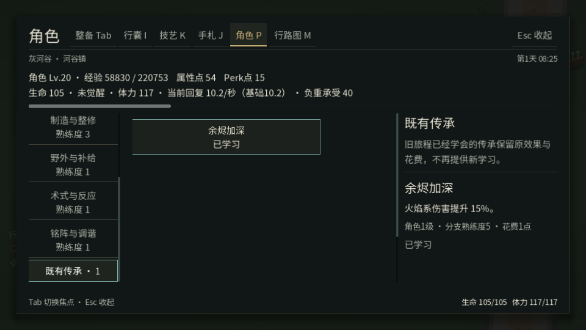

# 当前Perk路线验收

2026-11-14（上海）。基线`41402a8a97963546eca65e6aa9f78400360783f6`，最终运行源码`d879bd26389657db313145b229057863c973e19e`。本目录后续仅添加证据；[路线说明](../../PERK_ROUTES.md)记录全部当前路线与消费者。

## 交付

- 六条可学习路线、每条7个节点，共42个。四条日常技艺保留原20个ID并补8个末段；术式与反应、铭阵与调谐提供14个当前节点。
- 原20个法术节点保留已学效果、身份、前置和点数花费，只在“既有传承”查看。未学节点不再可买；schema2及旧熟练度存储编号保留，不复制XP、等级或预算。
- 新学习明确检查觉醒与相应基础操作/专业知识；Perk不授予法术、配方、剥皮技艺或物资。四条日常路线允许未觉醒者发展。
- UI保留实时世界、单次确认与锁定原因，六条路线分别呈现，末层可滚动查看，旧传承没有购买入口。
- AGENTS.md与开发工具文档改为默认按实际影响定向验证；只有广泛基础契约改变、未知影响或明确要求才扩大到全量，证据/文档提交不重复启动测试。

## 实际结果与边界

| 验证 | 实际结果 |
|---|---|
| 法阵 | 原凝能预算120/40变为144秒存续、每次消耗34秒；预览与实际布阵相同。学习不延长旧阵，真正组合减少34秒。 |
| 涂层 | 两个维护节点使真实60秒涂层成为84秒，仅写该武器截止时间，定义未变。 |
| 元素武技 | 基础18→21；实际波对碰撞开启的静止靶生命55→34，只消费一次涂层，MP46不变，冷重进保持已消费。近身、实物箭、波共用释放查询。 |
| 炼金 | 真正付一份原料批次，产两份火抹布；成品维持不可逆回收。新增目录测试拒绝给可回收材料或弹药错误叠加炼金产出。 |
| 专业取材 | 未学剥皮时拒绝Perk且不扣点；掌握后使用原部位/工具，兽皮1→2；预览不消费，完成消费原UID，再次完成拒绝。 |
| 操作特定条件 | 未掌握聚能投射时拒绝相应节点，掌握后实际冷却策略5→4.25秒。 |
| 保存 | 真实保存、销毁游戏、重新进入后，已学节点/点数及原实物消费结果一致。旧传承重复恢复不重发历史信用。 |
| UI | 实际P、鼠标选节点/确认、F5/F9、锁定节点、Tab、960×600与125%字号、学习后恢复及真实制造；正常AI/世界计时。 |

领域夹具保留原成长和库存事务，以受控获得的角色经验、实践、材料与知识覆盖高阶条件；不直接发可花Perk点。精确波伤害使用碰撞开启、仅决策冻结的原靶，不作为自然战斗平衡样本。输入中的觉醒/知识也是明确夹具，不能视为自然旅程已完成觉醒任务。

## 定向验证

```sh
python3 tools/run_tests.py --tests content gut_domain rpg_progression \
  weapon_enchantment fieldcraft spell_operations rpg_progression_input \
  --jobs 2 --timeout 120 \
  --source-revision d879bd26389657db313145b229057863c973e19e \
  --report /workspace/perk-routes-clean-targeted.json
```

从该提交git archive导出，无.godot缓存，**7/7定向通过，另首次导入通过**（JSON共8条结果），无跳过。GUT共34用例、无失败。对应原领域消费者、保存重进与实际输入均覆盖；**本轮没有运行全量**，未把以前的162项结果复用为本轮证明。

首次检查发现了汲取操作的知识ID使用旧操作名、法阵预览尚未携带执行者等问题，已修正为实际知识ID及同一上下文。夹具还修正了重开界面后的旧控件引用、扩展节点所需的受控经验预算，以及精确波靶必须保持物理碰撞注册的条件；没有删除伤害、费用、UID、容量或知识断言。最终结果见[targeted-results.json](targeted-results.json)，日志按用例名保留。

## 原生窗口与实图

同一提交的干净归档完成原生Xorg成长页输入，退出0，无ERROR/SCRIPT ERROR。窗口请求1152×648与960×600，后段125%字体；截图画布尺寸逐张记录在manifest.json（小窗截图960×540）。完整流程包括未觉醒拒绝、已掌握路线实际鼠标购买、旧档只读传承、末层滚动、Tab、保存重进和制造。

```sh
python3 -c "import tools.capture_ui as c; c.TESTS=('rpg_progression_input',); raise SystemExit(c.main())" \
  --output /workspace/perk-routes-native --tests rpg_progression_input --display 95
```

软件驱动报告一次不支持设置VSync的告警，已保留原日志；不作为目标硬件帧率或同步模式验证。输入成功与领域结果单独核对，没有屏蔽脚本错误。[原生结果](native-results.json)、[原日志](native-input.log)。






## 平台与限制

Linux云环境，Godot4.6.3，原生Xorg/X11、gl_compatibility、Mesa llvmpipe软件渲染、Dummy音频。图形检查不能代替目标GPU、音频或完整自然通关验收；本轮没有进行长期数值平衡。地图、故事与敌人规模未扩充，重点是当前玩法路线和真实效果。GitHub Actions保持停用。
