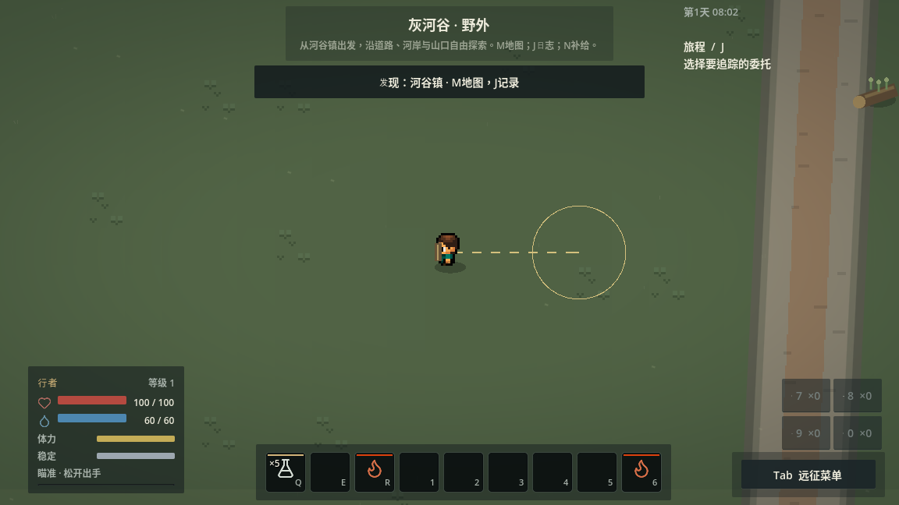
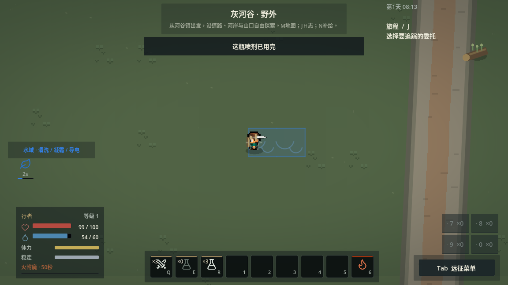
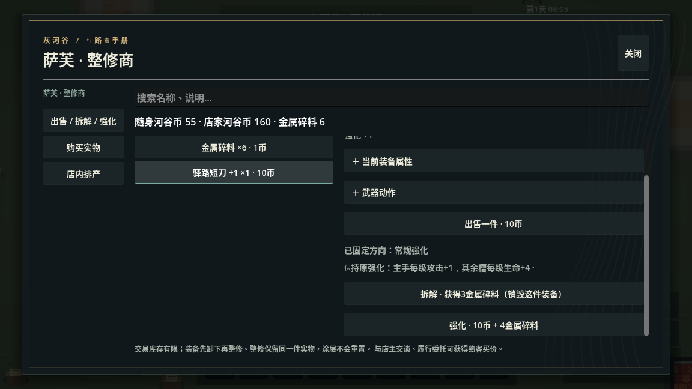
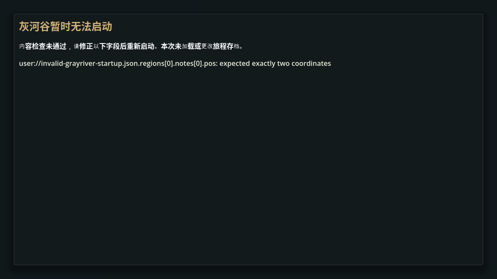

# 动作可靠性与内容预检验证

## 范围与平台

沿用当前地图、配方、敌人、角色与物资定义。本批验证投瓶预览、物品/喷洒反馈、内容预检入口和动态文案控件定位，不是自然新档通关或两小时Demo验收。

Godot 4.6.3，Linux云端。无头检查通过统一runner隔离存档；图形检查用原生窗口1152×648、Xorg dummy、Mesa llvmpipe兼容渲染和Dummy音频。输入用实际键鼠事件，交易仍点击滚动后的控件坐标。实物/知识/站位及伤害、UID迁移由受控夹具准备，原有AI和世界模拟保持正常运行；静止碰撞夹具不代表移动敌人预测。

## 定向结果

首次定向12/12通过：[报告](targeted.json)、[汇总](targeted.log)。包括内容/地图、原始负例、现有物品和喷洒、投瓶/反馈/交易实际输入、统一快捷槽、操作流程和NPC交互。最终反馈夹具改用清水后再次1/1通过：[报告](feedback-final.json)、[汇总](feedback-final.log)。Python工具测试20/20通过。

| 投瓶场景 | 预览距离 | 实弹撞击距离 | 实际消费 |
|---|---:|---:|---:|
| 墙体layer 1 | 166 | 166 | 1瓶 |
| 角色碰撞layer 2 | 166 | 166 | 1瓶 |
| 命中Area layer 8 | 166 | 166 | 1瓶 |
| 无遮挡 | 360 | 360 | 1瓶 |

同一输入测试覆盖Q按住/松开、左键确认、右键取消、旧松键不消费、自身RID及layer 4排除、真实油地面生成；独立障碍位置约束预览，非helper自比较。图形与无头落点数据一致，见[原生日志](native-throw_trajectory_input.log)。

反馈用例验证：涂附成功只扣1份且无取消提示；移动、受伤、换武器、缺体力或失去实物各出现一次对应反馈。清水喷洒首脉冲扣2MP和1剂，下一次缺MP停下，保留该瓶2剂；完整3剂瓶扣6MP后空瓶停下，另一瓶3剂不动。技能槽另测控制、失衡及初始缺MP，均不消费。主动取消和松键静默；不通过自动换瓶或退款通过测试。见[原生日志](native-item-feedback-water.log)。

交易测试主动改写强化、回购物品和课程按钮文案后，仍按人物、UID、课程身份真实点击；核对强化材料、买卖双方金币/件数、同一UID、单次交易事实和老师实际收款。还复走K武技、小时休息、药剂和弓箭输入，见[原生日志](native-depth_input.log)。

预检覆盖坏JSON、缺字段、类型错误、短坐标、未知发现模板、缺失/错型资源、地图空目录槽及有效内容预算。两次真实`grayriver.tscn`坏内容启动停止在bootstrap之前：无Session/ProgressService、不选存档槽、不加载旅程，预置主档/备份/归档字节不变，诊断可见。见[原生日志](native-content_preflight.log)。

## 原生首轮失败及修正依据

第一轮原生反馈用例使用毒喷剂，出现“受伤中断喷洒”，空瓶和失去UID的后续断言失败（[原始日志](native-feedback-toxic-first-failure.log)、[现场截图](toxic-first-failure.png)）。截图可见中毒状态和持续3点毒伤：地面按64单位格传播，受控角色站位进入自己喷出的毒地，正确的受伤中断先于预期耗尽。这是资源边界用例混入了地面危害，不能把此次运行记作空瓶通过。

最终资源反馈用例改用同样3剂、同一基础动作的清水喷剂，原有精确费用/UID/反馈断言保留；正常AI、地面规则、毒伤和中断均未停用或修改。实际毒剂命中/墙体及费用继续由既有`item_actions/spray_channel`检查。近脚毒地风险不是本轮平衡结论，仍应在后续自然战斗中单独评估。

最终四项原生检查均退出0且断言通过，无SCRIPT ERROR/ERROR；各有一条Xorg驱动“不支持切换V-Sync”的WARNING，原样保留。不能称原生日志零警告，也不作目标设备性能或真人手感结论。

## 冻结归档回归

在下方追加冻结提交、冷导入及完整runner最终结果；完整回归期间不改源码、不同时启动其他Godot。
